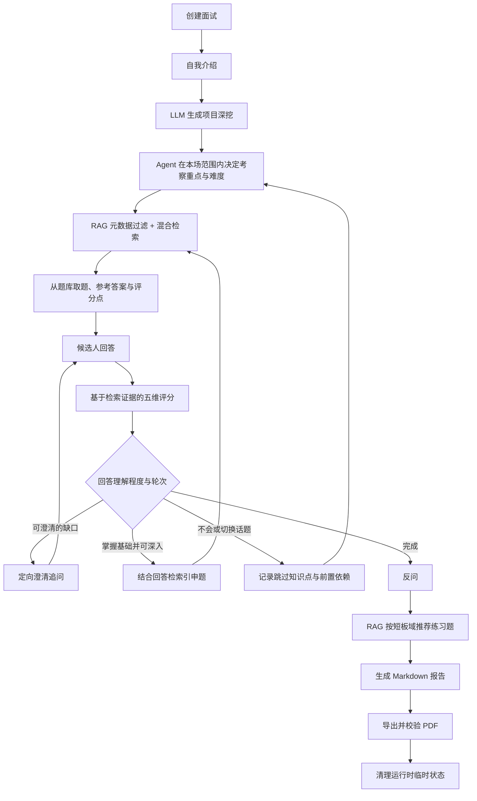

# InterviewPilot · Agent 智能面试学习平台

InterviewPilot 是一个面向计算机学生的校招简历副项目，业务闭环是：

**模拟面试 → 发现短板 → 针对性学习**

它不是把面试题包装成聊天机器人，而是由一个有状态的 Agent 面试引擎主动控制流程：
维护会话阶段、自主选题、根据评分调整难度、低分时澄清追问，并在结束后生成逐题复盘和
短板学习推荐。底层沿用 `techrag` Python 包名和 CLI 命令，RAG 是引擎的核心工具。

项目功能、实现细节、整体流程与逐功能面试问答，见
[项目详解与面试问答](docs/project-guide-and-interview.md)。

## 第一版可验收范围

- 技术面 / 行为面，共用一套持久化状态机
- FastAPI 网页面试：动态题库选择、对话作答、历史恢复与报告下载
- 独立知识库问答：复合问题拆解、混合检索、MQE/HyDE 扩展、本地 Cross Encoder 精排、来源原文与问答历史
- 在线题库管理：创建题库、浏览/搜索/编辑题目、只填题目与答案后由 AI 补全信息，并自动更新检索索引
- 5 / 10 / 15 轮，自适应难度或锁定难度
- 自我介绍 → 项目深挖 → 正式问答 → 候选人反问 → 报告
- 题目按面试类型、知识域、难度做元数据过滤，再执行向量 + BM25 + RRF 混合检索
- 评分严格引用当前题目的参考答案与评分要点；低分回答只触发一次定向澄清
- 面试官先回应候选人的具体回答，再做单点追问；“不知道”记录不会的知识点并换题，
  请求解释会保留当前题目，明确说“跳过”则结束本题
- 正式轮次按主问题计算，追问不占新轮次；评分结合本题首次回答与补充回答
- 五维能力、知识域短板、逐题回答、Agent 决策与检索证据回放
- 针对短板域再次检索题库，生成可直接练习的学习推荐
- 面试完成后自动生成中文 PDF，并在确认生成成功后清理运行时临时状态
- Chroma 同时保存知识索引、面试会话、每轮评分、Agent 决策和报告登记信息
- 内置 86 道大模型技术题与 12 道行为题，每道题均有参考答案和评分要点

首版暂不包含语音/摄像头、截图、多用户权限和长期能力档案；这些属于
核心闭环稳定后的通道与展示层，不影响面试状态机接口。

## 演示

### 网页面试（推荐）

FastAPI 提供接口并托管 HTML/CSS/JavaScript 页面，不需要 Node.js 或单独启动前端。
同步依赖后在项目目录运行：

```powershell
uv sync --extra dev
.\.venv\Scripts\python.exe -m techrag web
# 浏览器打开 http://127.0.0.1:8000
```

页面支持选择题库、限定知识点、轮次与难度、对话作答、历史恢复、提前结束、报告查看和 PDF/Markdown 下载。
侧栏“知识库问答”可以直接提问，也可以一次提出多个问题。面试最后的技术反问共用这一检索流程；
致谢、流程交流和真实公司信息会单独处理，公司内部信息明确交由真实招聘方确认。
题库选项来自当前 Chroma 中实际入库的题目。导入新方向后点击“刷新题库”即可看到，不需要修改前端。
可以换数据库或端口：`techrag --db data/test-interview-chroma web --port 8001`。

例如未来新增 `data/interview_questions/java.md`，在文件头填写 `domain: java`、
`interview_type: technical`，沿用下方题库格式并使用唯一题号（例如 `J001`），导入后页面会显示 Java。
当前未入库的方向不会显示为可选题库。

网页服务默认只监听本机地址，复用现有 `.env` 中的模型配置。请使用单进程运行；
写入操作在服务内串行处理，并校验对话版本以避免重复提交导致重复推进。

### 在线维护题库

打开侧栏“题库管理”，选择现有题库，或点击“创建新题库”填写题库名称。
AI 自动生成领域分类、面试类型与简介。空题库可以在管理页继续维护，
添加第一道题后才会出现在模拟面试和知识库问答的可选范围中。

新增或编辑题目时，仅填写“题目”和“参考答案”，点击“AI 补全并保存”。
AI 根据答案生成难度、标签、具体知识点、前置知识与评分要点，题目和答案保留用户原文。
评分要点只应覆盖答案已有内容；生成结果在保存后展开供查看，
前置知识限定在题库现有知识点中，并排除本题自身知识点。
每道题仍为一个完整父块，只在题内建立子块向量与 BM25 索引。

网页编辑不会覆盖 `data/interview_questions` 中的原始 Markdown。
每道线上题的完整版本写入 `data/online_question_banks/{题号}.md`，
同时按稳定题号覆盖 Chroma 中的当前题目，不重复新增父块。
可以点击“导出本题库 Markdown”保存包括原有题和线上修改的完整题库。
重新导入原始目录时，已有线上版本优先，避免旧文件意外覆盖网页修改；
已有线上题继续从网页修改，导出的 Markdown 可用于新数据库的完整导入。

保存先生成并校验辅助信息，再索引和发布 Markdown；生成或索引失败时旧版本仍可用，
Markdown 发布失败时使用原向量恢复旧索引，不需要再次调用 Embedding API。
网页保存请求带唯一标识，重复提交只处理一次；修改需要匹配读取时的版本，
过期修改返回冲突并保留本地草稿。已保存的历史面试及当前题目的评分上下文不被改写。

接口：`GET/POST /api/library/banks`、`GET/POST /api/library/banks/{key}/questions`、
`GET/PUT /api/library/questions/{id}`、`GET /api/library/banks/{key}/export`。
编辑接口仅接受题目、答案、版本与请求标识，不要求用户填写生成字段。

### 知识库问答检索流程

```text
用户提问 → 最多 5 个独立子问题（比较或依赖问题保留在一起）
  每个子问题：原问题 + MQE 同义改写 + HyDE 假设文本
    → BM25 关键词检索 + Chroma 向量检索
    → RRF 融合与父块去重
    → 本地 Cross Encoder 对「子问题、资料」联合打分
    → 相关性过滤 → 完整父块作为证据 → 带引用回答
  按子问题汇总答案、来源与实际执行的检索步骤
```

网页默认启用拆解、MQE、HyDE 和精排，可在“检索选项”关闭以比较效果与耗时。
HyDE 只参与向量召回，假设文本不会进入回答证据。每个子问题默认保留 3 个父块，
题库父块不会被裁成半个答案；超过上下文预算的完整资料会跳过并说明。
无匹配资料、模型判定资料不足或引用校验失败时，明确说明无法依据知识库回答。
引用编号在整次问答中统一；可以展开原文核对，问答历史不会作为新的检索资料入库。
MQE/HyDE 或精排失败时，保留原问题混合检索，并在页面提示实际回退情况。

本地精排使用多语言 `cross-encoder/mmarco-mMiniLMv2-L12-H384-v1` 的 INT8 ONNX 版本，
无需 GPU 或 PyTorch；固定模型版本并校验 SHA-256。首次使用在项目目录运行一次：

```powershell
.\.venv\Scripts\python.exe -m techrag prepare-reranker
```

模型和分词器约 136 MB，存放在 `models/mmarco-cross-encoder`，不会提交到版本库。
模型每对输入上限 512 token，只截断精排输入，生成回答仍使用完整父块。
相关性阈值默认 `0.05`（sigmoid 后的分数，不能解释成准确率），
可通过 `TechRAGConfig.knowledge_min_rerank_score` 调整，应结合实际题库评估。
缺少模型时问答依然可使用混合检索，页面会显示精排未执行。

API：`POST /api/knowledge/ask`，支持 `question`、`domains`、`decompose`、`mqe`、
`hyde`、`rerank`、`top_k`。返回分题答案、真实来源和各子问题的检索轨迹。
`GET /api/knowledge/history` 与 `GET /api/knowledge/answers/{id}` 用于恢复历史问答。

### 检索评测与逐点评分

侧栏“检索评测”支持快速 6 题或完整 20 题，对比向量检索、混合检索、
混合 + MQE/HyDE、混合 + MQE/HyDE + Cross Encoder 四种方案。
每题先拆解一次，所有方案复用相同子问题，轮换执行顺序；回答和引用仍走实际知识库流程。
评测会调用已配置的模型 API，不修改题库、不把评测答案当作检索资料。
当前服务串行执行，评测期间其他操作会等待。CLI 也可以运行：

```powershell
.\.venv\Scripts\python.exe -m techrag eval --compare --limit 6
# 完整运行，或只比较两种方案
.\.venv\Scripts\python.exe -m techrag eval --compare
.\.venv\Scripts\python.exe -m techrag eval --compare --variant vector --variant hybrid
# 只测检索和问答耗时，关闭额外的答案评审调用
.\.venv\Scripts\python.exe -m techrag eval --compare --limit 6 --no-answer-judge
```

`data/evaluation/knowledge-v1.json` 是独立编写问法的种子标注集，覆盖精确问法、
同义表达、复合问题、比较、跨方向和无资料案例；标记为 `seed_requires_human_review`。
它不是已人工验收的生产基准。每条 `expected_sources` 标注需要覆盖的目标来源，
不穷举所有等价证据；请人工检查漏标和误标，必要时补充其他合理来源。
自定义评测集使用 `--dataset 文件.json`，结构包含 `name`、`label_status`、`cases`；
每个案例包含唯一 `id`、`question`、`category`、`domains`、`answerable`、`expected_sources`。
可选 `reference_points` 为非空字符串数组，定义答案必须正确覆盖的要点；
也可以提供 `reference_answer`，未提供要点时将整段参考答案作为一个评分点。
内置17道可回答题已补充种子参考要点，仍需人工复核；不要求逐字匹配。
可选 `source_relevance` 是来源到1至3整数的映射，来源必须属于 `expected_sources`，
未指定的相关来源按1级计算，用于nDCG的分级相关性评估。
无答案案例必须设置 `answerable: false` 且来源数组为空。
未入库的目标来源会在调用模型前报错，避免把缺失题库误当作检索失败。

结果保存在 `reports/evaluations/{id}.json` 和 `.md`，网页可以恢复历史并下载 JSON。
记录题库/评测集指纹、模型、检索配置、相关性阈值、每题答案/来源/轨迹及实际降级信息。
Recall@3 计算每题标注来源的覆盖比例，多个子问题分别取 3 个完整父块；
MRR 取首个相关来源在子问题列表中的最佳倒数排名；无答案案例单独计算正确拒答率，
有答案案例记录误拒答率。失败案例不计效果均值，完成率和失败数单独展示。
新增 Precision@3、Hit Rate@3和nDCG@3：Precision固定以3为分母，未返回满3条也不会
缩小分母；Precision和nDCG分别在子问题列表上计算再求平均，nDCG采用整题来源标注，
复合题结果不等同于单独标注每个子问题的标准nDCG。目标来源标注不完整时，
Precision和nDCG可能低估真实相关性，需结合逐题资料复核。

默认额外调用一次答案评审，独立于生成请求；网页可取消“评估回答质量”，CLI使用
`--no-answer-judge`关闭。评审默认复用生成模型，Python调用可通过`judge=`注入不同模型。
评审返回事实原文、资料证据、引用判断、参考要点覆盖及相关性理由；程序校验连续原文、
证据出处、引用编号及评分范围。忠实度按有证据支持的事实比例计算，引用准确性按
事实—引用对统计，引用覆盖率按带引用事实比例计算。答案正确性为正确且相关的事实
精确率与参考要点覆盖率的F1；无参考答案/要点时为未评估。回答相关性为模型0至1评分。
纯拒答没有事实时，忠实度及引用指标为未评估，而不是满分。评审失败保留检索结果，
不计入质量均值；所有指标记录有效样本数，网页和Markdown可查看逐项评审证据。
模型语义判断及事实拆分完整性仍需人工抽查，不能把出处校验当作正确性证明。

记录具体阶段耗时（单位秒）：共有拆解、检索总计、MQE、HyDE、Embedding、向量检索、
BM25、精排、答案生成与校验，以及单列的答案评审。每阶段汇总均值、P50、P95和最大值。
检索总计包含扩展、Embedding、向量/BM25等子阶段，不能重复相加；问答总耗时为共有
拆解加方案pipeline，包含冷启动，不含额外评审、HTTP排队及报告写盘。当前为非流式
问答，不记录首Token延迟；整个评测的墙钟时间另存`benchmark_wall_seconds`。
保留调用次数与精排实际执行情况，评审调用量单列，旧报告仍能打开，新指标显示未评估。
应用层调用数不等于 token 用量、供应商重试次数或费用。
单次对比会受模型生成随机性、冷启动和小样本影响，不能据此宣称某个组件必然提升效果。
引用合法也不等于答案正确，逐题事实支持仍需人工复核。

新面试的评分要点生成稳定编号 P1/P2 等，模型逐项评价“掌握、部分掌握、存在错误、
未涉及、待核验”，合并本题首次和补充回答，认可合理的等价解法。
掌握/部分掌握/错误必须携带编号回答中的连续原文；程序核对回答编号和原文是否真实存在。
伪造原文、遗漏评分点、重复编号或无效状态会标为“待核验”，不会展示伪造引用。
原文校验只保证出处存在，语义判断仍由模型作出，不把它当作客观认证。
网页复盘与新导出的 Markdown/PDF 保留逐点判断、原因及引用；旧记录不重新评分。
评分服务失败时继续明确显示降级评分，逐点评价全部为待核验。

接口：`GET /api/evaluations`、`POST /api/evaluations/run`、
`GET /api/evaluations/{id}`、`GET /api/evaluations/{id}/download`。
运行接口仅接受案例范围和内置方案，禁止用户提交服务器文件路径。

### 命令行入口

```powershell
# 初始化独立演示数据库并导入 98 道结构化题目
uv run techrag --db data/chroma questions import data/interview_questions

# 技术面：5 轮、自适应难度
uv run techrag --db data/chroma interview start `
  --mode technical --rounds 5 --difficulty-policy adaptive --difficulty 2

# 行为面：锁定难度
uv run techrag --db data/chroma interview start `
  --mode behavioral --rounds 5 --difficulty-policy locked --difficulty 2

# Ctrl+C 后可用终端显示的 session ID 恢复
uv run techrag --db data/chroma interview resume SESSION_ID

# 面试结束时会自动写入 reports/interview-SESSION_ID.pdf
# 也可以随时查看报告，或重新导出 Markdown/PDF
uv run techrag --db data/chroma interview report SESSION_ID
uv run techrag --db data/chroma interview report SESSION_ID --output reports/demo.md
uv run techrag --db data/chroma interview report SESSION_ID --pdf reports/demo.pdf

# 删除会话、逐题记录和报告；--keep-pdf 可只保留最终 PDF
uv run techrag --db data/chroma interview delete SESSION_ID --keep-pdf
```

面试方向从已入库题目的 `domain` 动态发现，新增 Java、MySQL 等题库无需修改选题代码。
不指定范围时，已入库的同类型题目组成候选池，选题结合项目经历和回答表现，不要求覆盖所有方向。
可重复传入 `--domain` 限定本场方向，或重复传入 `--topic` 按知识点/标签限定范围；多个知识点取并集，
方向和知识点约束同时生效。范围不会因题目不足自动扩大。

```powershell
# 查看已入库的面试类型、方向和题目数量
uv run techrag questions domains

# 只面 Agent 与 RAG
uv run techrag interview start --domain agent --domain rag

# 导入相应题库后，只考 MySQL 的索引与事务
uv run techrag interview start --domain mysql --topic B+树索引 --topic 事务隔离
```

回答后，评分模型同时判断是继续追问、引申相关题还是开启新话题。追问复用当前题参考资料；
引申查询包含原题、本题回答（含补充回答）和下一步考察重点；第一道正式题的查询包含自我介绍与项目回答。
这些查询通过已配置的 DashScope Embedding API 生成向量，再检索 Chroma 中的题库。
长文本会截断以控制查询长度，面试范围、已问题及不会的知识点始终作为检索过滤条件。
新话题优先避开当前知识点。
连续引申最多两道正式题，追问仍不占正式轮次。每次检索前先排除已问题、不会的知识点及依赖它们的题，
再按难度筛选；没有相应难度时仅放宽难度。范围内无合适题时提前进入反问和报告阶段。

终端会区分“正式问答”“本题追问”“本题提示”和“问题解释”。例如回答
“原理就是工具调用”后，面试官应承接这个说法，从一个具体环节继续问，而不是
一次要求说明全部评分点。每题最多一次追问；明确表示不会或跳过时直接记录知识点并换话题，
后续不再考同一知识点或依赖它的进阶题。这个跳过仅针对本场面试，复盘推荐仍可包含这些短板。
请求解释不评分、不消耗正式轮次。评分服务不可用时，终端与报告会说明降级评分。

## Agent 与 RAG 的关系



这里 RAG 不只是“面试题搜索”：它为出题提供题目与难度约束，为评分提供参考答案和评分点，
为报告保留来源证据，并在短板确定后再次参与学习推荐。Agent 负责决定何时检索、检索什么、
何时追问以及如何转移状态。

报告成功生成后，只清除会话状态中重复的自我介绍、当前参考答案、评分点和追问计数等
运行时字段。逐题问题、最终回答、评分、反馈、Agent 决策和来源继续以结构化记录保留，
用于复盘和重新生成报告。显式执行 `interview delete` 才会删除整个会话历史。

## 题库格式

每个 Markdown 文件对应一个知识域，每道题是独立的二级标题。导入时会校验题号、难度、
参考答案与评分要点，并按题号把每题作为独立文档、一个完整父 chunk 建立索引。
父块完整保存题目、参考答案和评分点，不受通用文档的长度与语义切块规则影响；
题内子块负责向量和 BM25 召回，每个子块都带题号、标题和知识域。多个子块命中后
聚合回同一父块，评分始终读取完整题目。这条题库规则也适用于关闭通用层级检索的配置。

题库格式示例：

参考答案和评分要点可以包含多段内容、列表和代码块，后续段落建议缩进两个空格。
解析与评分会保留整个字段，直到下一个题库字段或下一道题。

```markdown
---
domain: rag
interview_type: technical
---

## R001｜什么是 RAG？

- 难度：基础
- 标签：RAG、检索增强生成
- 知识点：RAG基础
- 参考答案：……
- 评分要点：……

---
```

可选字段 `知识点` 和 `前置知识` 用于选题路由，多个值用 `、` 分隔，名称需保持一致。
例如 MySQL 题可标注 `知识点：覆盖索引`、`前置知识：B+树索引`；明确不会 B+树索引时，
同知识点题及依赖它的题都会被排除，依赖链会继续传播。不要把整个 Java/MySQL 方向作为每题的知识点。
旧题未标注知识点时兼容使用标签，无标签时使用题目标题，此时无法可靠识别相关题的共同知识点。
这些路由字段保存为元数据；只修改它们再导入时会刷新元数据并复用向量，不调用 Embedding API。

技术题的问题目录来自 [小林面试笔记](https://xiaolinnote.com/ai/)，答案基于其公开题解重新整理，
没有逐字复制正文；行为题由本项目为 STAR 面试流程编写。

86 道技术题的参考答案补充了机制、具体例子、工程取舍与常见误区，各题的“参考资料”
链接可用于继续阅读。答案用于理解与复盘，评分关注核心概念和逻辑，不要求逐字背诵
所有扩展细节。修改 Markdown 后，需要重新导入题库，数据库中的参考答案才会更新：

```powershell
.\.venv\Scripts\python.exe -m techrag --db data/test-interview-chroma questions import data/interview_questions
```

同题号会更新既有文档；已经开始的面试可能仍保存当前题目的旧参考答案，重新导入后
建议新开一场面试验证。

父块规则具有独立索引版本，首次用新版重新导入时会替换旧题目的切块与子块索引，
之后内容和子块配置都没变化的题目会跳过重复索引。

## RAG 基础能力

- 文档统一规范化为 Markdown，按标题树、段落/代码块边界和 token 预算智能切块
- Markdown 单元语义分割、章节级重叠以及“子块检索—父块返回”的层级索引
- Chroma 文档、父 chunk、检索子块、向量、关键词、元数据和评测集持久化
- 独立关键词检索、向量检索以及基于 RRF 的混合检索
- 可选 MQE/HyDE 扩展检索，统一执行“扩展—检索—去重融合”流程
- 中文单字/双字与英文单词 BM25，避免中文依赖空格分词
- 可选 BGE 多语言 Cross-Encoder 重排器，也可以注入自定义/API 重排器
- 元数据过滤、列表值 OR 语义和可选 LLM self-query
- 邻近 chunk 扩展与 chunk span 合并
- 自适应检索、多轮消息、XML 长上下文提示、同步和流式生成
- PDF 专用 `pdftext` 转 Markdown；其他格式通过 Microsoft MarkItDown 转换
- 合成评测集生成、Recall@K、MRR 与可选答案覆盖率评测
- 文档批量写入、内容去重、同来源更新和删除
- 固定使用 `dashscope/text-embedding-v4` 与 `deepseek/deepseek-v4-flash`
- Python API 与 CLI

根据项目范围，明确不实现：Pandoc、Mistral OCR/图片描述、Query Adapter、MCP Server、Chainlit Web UI、Slack/Teams 集成和 PostgreSQL。

## 实现取舍

RAGLite 的句子/语义切块使用更复杂的优化方法，late chunking 也依赖底层模型 token embedding。TechRAG 为便于理解与演示，使用以下轻量实现：

- Markdown 切块：标题层次优先，保护代码围栏、表格/列表和段落边界，再按相邻单元
  余弦相似度与 token 预算切分；仅对超长原子单元执行硬切分
- token 预算：由于 LiteLLM 不暴露当前 embedding 模型的 tokenizer，使用稳定的中英混合
  token 估算（中文字符、英文词和标点）
- 层级检索：章节级父 chunk 保留完整上下文，较小的 Markdown 子块负责关键词和向量
  召回；多个子块命中按父 chunk 取最高分聚合，再返回父块及邻近上下文
- 扩展检索：原始查询、MQE 多查询和 HyDE 假设文档批量向量化，各路候选按 chunk ID
  去重并用 RRF 合并，最后使用原始查询重排
- 重排：核心安装默认不重排；显式注入 `Reranker` 后，对扩大召回的候选集执行二阶段排序
- 自适应检索：识别问候等无需知识库的问题，其余问题执行检索
- 向量检索：子块向量交给本地 Chroma 的 cosine HNSW 索引，批量查询支持 MQE/HyDE；
  扩大子块候选后按父块聚合，避免同一题的多个子块挤占父块结果
- 关键词排序：本地 Chroma 的文本过滤不等于 BM25；中文单字/双字和英文词频存入
  子块元数据，应用层计算 BM25，再与向量结果执行 RRF 融合
- 结构化记录：会话、逐轮评分、报告登记和评测集按 ID 保存为 Chroma JSON 文档，
  使用固定占位向量，不调用 Embedding 服务，也不参与知识检索
- 更新一致性：先写新父块与子块，再发布文档版本，最后清理旧数据；检索忽略未发布版本。
  这是面向本地单写入进程的应用层协议，多个 collection 之间没有关系数据库事务保证

这些能力在接口和流程上对应 RAGLite，但不是算法级完全等价。

## 安装

要求 Python 3.11+。安装核心、开发和文档转换依赖：

```bash
uv sync --extra dev --extra documents
```

如需本地 BGE Cross-Encoder 重排，额外安装可选依赖（首次使用时会下载模型）：

```bash
uv sync --extra rerank
```

复制配置模板并填写模型密钥：

```powershell
Copy-Item .env.example .env
```

```dotenv
DASHSCOPE_API_KEY=your-dashscope-api-key
DEEPSEEK_API_KEY=your-deepseek-api-key
```

核心索引与生成固定使用以下两个模型，LiteLLM 仅作为调用适配层：

```text
embedding: dashscope/text-embedding-v4
llm:       deepseek/deepseek-v4-flash
```

只有显式启用二阶段重排时，才会额外加载 `BAAI/bge-reranker-v2-m3`。

项目启动时会自动从当前目录或其父目录查找 `.env`，并以项目 `.env` 中的值为准。
`.env` 已加入 `.gitignore`，不应提交真实密钥。

## CLI

```bash
# 初始化 Chroma collections
uv run techrag init

# PDF 使用专用转换器；DOCX/PPTX/XLSX/HTML 等使用 MarkItDown
uv run techrag add docs/manual.pdf docs/design.docx docs/readme.md

# 路径可以是相对路径或绝对路径；同一次添加的文件共享这组文档元数据
uv run techrag add docs/guide.md --metadata '{"language":"zh","topic":"rag"}'

# 三种检索方式
uv run techrag search --mode keyword "中文关键词"
uv run techrag search --mode vector "cross-language semantic query"
uv run techrag search --mode hybrid "Chroma 如何存储向量？"

# 高召回扩展检索（全局参数需放在子命令前）
uv run techrag --mqe --hyde search "Chroma 如何存储向量？"

# 使用可选的 BGE Cross-Encoder 对召回候选进行二阶段重排
uv run techrag --reranker bge search "Chroma 如何存储向量？"

# 元数据过滤
uv run techrag search --filter '{"language":"zh","topic":["database","rag"]}' "索引"

# 普通或流式问答
uv run techrag ask "TechRAG 如何执行混合检索？"
uv run techrag ask --stream "How does reranking work?"

# 数据维护与评测
uv run techrag stats
uv run techrag delete docs/readme.md
uv run techrag eval --generate 10
uv run techrag eval --answers
```

全局参数必须写在子命令前：

```bash
uv run techrag --db data/knowledge-chroma --self-query search "2026 年数据库资料"
```

默认持久化目录是 `data/chroma`。`--db` 和 `--chroma-path` 是同一个参数，
现在接收目录路径；Chroma 自己管理目录中的存储文件，不再打开旧数据库文件。

存储分为四个 collection：`techrag_documents` 保存来源与索引版本，
`techrag_parents` 保存完整父块，`techrag_children` 保存子块向量与词频，
`techrag_records` 保存会话、报告、评分历史与评测记录。

## 旧数据迁移

程序和核心依赖已移除 DuckDB。旧文件仍可通过一次性只读导出工具迁移；
导出工具所需的旧数据库驱动只在临时环境中安装，不属于项目运行依赖：

```powershell
uv run --no-project --with duckdb scripts/export_legacy_duckdb.py data/test-interview.duckdb tmp/legacy-export.json
.\.venv\Scripts\python.exe -m techrag --db data/test-interview-chroma migrate tmp/legacy-export.json
```

迁移复用原向量，不调用模型；保留会话 ID、逐轮记录和报告路径，不修改旧文件。
重复迁移会跳过已有来源和记录，不覆盖已经继续进行的面试。
当前工作区旧测试库已迁移到 `data/test-interview-chroma`，并合并到默认 `data/chroma`；
旧通用知识库也已迁移到默认目录。修改题库后仍需重新导入，以更新答案和子块索引。

## Python API

```python
from techrag import TechRAG, TechRAGConfig

config = TechRAGConfig(
    db_path="data/chroma",
    search_mode="hybrid",
    semantic_chunking=True,
    markdown_chunking=True,
    hierarchical_retrieval=True,
    child_chunk_size=180,
    child_chunk_overlap=30,
    self_query=False,
    enable_mqe=True,
    enable_hyde=True,
    candidate_pool_multiplier=4,
)

with TechRAG(config) as rag:
    # 相对路径会在内部解析为绝对路径，用作稳定的文档来源标识。
    rag.add_file("docs/guide.pdf", metadata={"language": "zh-en"})
    rag.add_text(
        "Chroma 是支持向量索引和元数据过滤的检索数据库。",
        source="chroma-introduction",
        metadata={"language": "zh", "topic": "database"},
    )

    keyword_results = rag.keyword_search("Chroma 索引")
    vector_results = rag.vector_search("vector database with metadata filters")
    hybrid_results = rag.hybrid_search(
        "如何保存 embedding？",
        metadata_filter={"language": ["zh", "zh-en"]},
    )

    spans = rag.retrieve_chunk_spans(hybrid_results)
    answer = rag.ask("How are vectors persisted?", history=[])
    print(answer.text)

    for token in rag.stream("请用中文总结", on_retrieval=lambda rows: print(rows)):
        print(token, end="", flush=True)
```

## 重排器

Embedding 与 LLM 固定不变。核心安装没有默认重排器；安装 `rerank` 可选依赖后，
可以注入 BGE 多语言 Cross-Encoder：

```python
from techrag import BGEReranker, TechRAG

rag = TechRAG()
reranker = BGEReranker()
results = rag.search("Chroma 如何存储向量？", reranker=reranker)
answer = rag.ask("Chroma 如何存储向量？", reranker=reranker)
```

模型在第一次重排时加载。CPU 默认使用 FP32；确认运行环境支持半精度时，可以传入
`BGEReranker(use_fp16=True)`。同一个重排器对象可以在多次请求间复用，避免重复加载模型。
如果所有请求都要重排，也可以在构造 `TechRAG` 时作为全局默认值注入：

```python
rag = TechRAG(reranker=BGEReranker())
```

也可以实现相同接口，接入其他本地模型或重排 API：

```python
class MyReranker:
    def rank(self, query: str, documents: list[str]) -> list[float]: ...

results = rag.search("query", reranker=MyReranker())
```

## 层级检索

默认将章节级父 chunk 继续拆成较小的 Markdown 检索子块。关键词与向量检索在子块层
执行，同一父块的多个命中取最高分聚合；进入重排和生成阶段的仍是完整父 chunk。

```python
config = TechRAGConfig(
    chunk_size=700,
    child_chunk_size=180,
    child_chunk_overlap=30,
    hierarchical_retrieval=True,
)
```

旧数据库首次打开时会自动为已有 chunk 回填单个兼容检索表示。要获得真正的子块索引，
需要使用当前配置重新添加原始文档。

如果数据库之前由其他 embedding 模型创建，请使用新的数据库文件并重新索引，不能混用旧向量：

```bash
uv run techrag --db data/chroma-v4 add docs/guide.md docs/manual.pdf
```

## 评测

新增简历项目证据流程：见 [实验与验证流程](docs/evaluation-plan.md) 和
[架构、演示与简历草稿](docs/project-evidence.md)。保留原20题网页种子回归集，另有120题分组检索集、
24题评分集，已由项目作者人工复核并认可原标注（2026-10-12），逐条保存复核记录。
新增MQE、HyDE和纯混合加精排三个独立消融方案。
CLI `eval --ablation`支持开发/测试选择、重复运行、配对差值与分类分析；
`score-eval`调用生产逐点评分逻辑并记录一致率、待核验率及混淆矩阵。
运行 `python scripts/check_evidence.py`可离线校验并生成复核工作表。
完整开发/测试阶段见[正式评测协议](docs/full-evaluation-protocol.md)，支持逐项断点保存、
配置与数据指纹校验、防重复启动，以及余额/认证失败早停。本轮完整外部API范围已获授权并启动，
账户余额恢复后已完成960条正式检索结果和40条回答质量评审；结果与有效样本量见
[完整评测状态](reports/full-evaluation/summary.md)，简历条目见[简历项目稿](docs/resume-project.md)。
完整分析保留首轮失败、断点恢复和指标局限，见[正式结果分析](reports/full-evaluation/analysis.md)。

```python
from techrag import EvaluationCase, evaluate, generate_evals

cases = generate_evals(rag, num_evals=20)
report = evaluate(rag, cases, top_k=5, evaluate_answers=True)
print(report.recall_at_k, report.mean_reciprocal_rank, report.answer_coverage)

manual_cases = [
    EvaluationCase(
        question="Chroma 是什么？",
        expected_sources=("docs/chroma.md",),
        reference_answer="Chroma 是支持向量索引和元数据过滤的检索数据库。",
    )
]
```

## 验证

```bash
uv run pytest
uv run ruff check src tests
```
