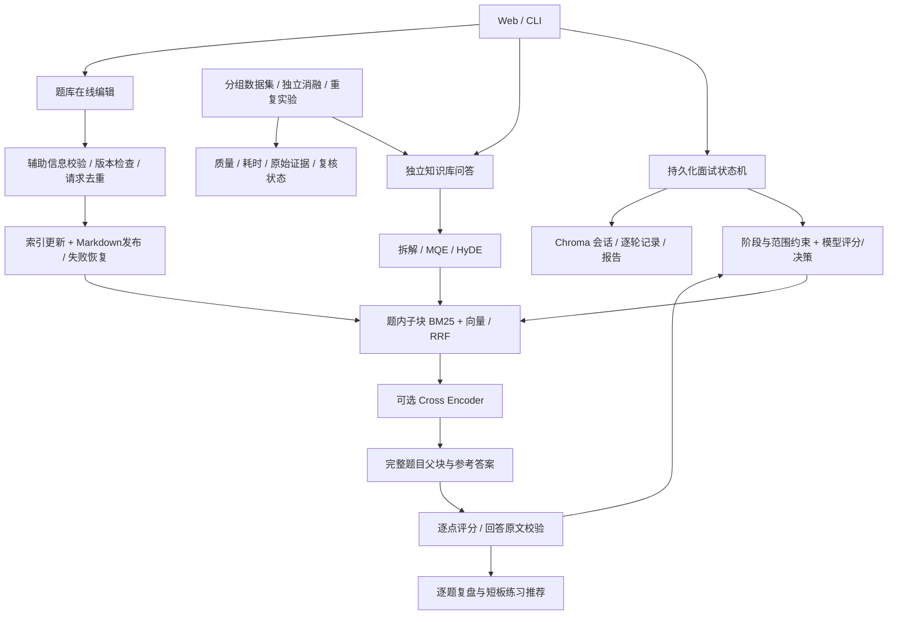

# InterviewPilot 项目证据与简历草稿

正式开发与测试检索评测已完成：80条开发查询×3方案×3轮，以及40条测试查询×2方案×3轮，
共960条检索方案结果，无失败或检索降级。40条回答及有效质量评审也已完整保存，见
[完整评测状态](../reports/full-evaluation/summary.md)。
开发集按预定规则选出组合扩展方案，在读取测试结果前冻结。
独立测试集中37条可回答问题、3条无资料问题；来源Recall@3仅统计可回答问题，
基线与扩展方案均为1.0000。MRR由0.9775变为1.0000，配对差值95%分组bootstrap区间为[0, 0.061905]，
不能据此宣称稳定显著收益；平均检索流程时间由5.143秒增至26.094秒，约5.07倍。
测试集的排序变化仅出现在两条术语问题的五次配对观测，逐题变化保存在原始结果中。
检索阶段三进程并行，不生成答案，这些时间不是最终问答时延。
详细结果见[开发报告](../reports/full-evaluation/dev.md)和[独立测试报告](../reports/full-evaluation/test.md)。

## 正式回答质量结果

40条测试问题各保留一份最终问答与独立模型评审。首轮35条评审有效、5条无效；
35条有效记录原样复用，只重试无效项，合计46次评审尝试，6次未取得有效评审。
重试会重新生成该条回答，不是仅给原回答重打分；全部失败与恢复记录保留在
[分析报告](../reports/full-evaluation/analysis.md)和[首轮原始报告](../reports/full-evaluation/quality-first-pass.json)中。

| 自动辅助指标 | 按回答取均值 | 有效回答数 |
| --- | --- | --- |
| 事实受资料支持比例 | 0.9960 | 37 |
| 事实精确率与参考要点覆盖F1 | 0.6667 | 37 |
| 回答相关性 | 0.9587 | 40 |
| 引用支持比例 | 0.9965 | 37 |
| 事实引用覆盖率 | 0.8798 | 37 |

上述指标由生成模型的另一次评审调用给出，程序只核验结构和原文出处，不是人工准确率。
30条可回答问题使用一段完整参考答案作为一个覆盖要点，7条复合问题使用两个参考要点；
覆盖判断较粗。例如V2-006的事实全被判断正确，但因未包含参考段落中的示例等内容，覆盖为0，F1也为0。
因此不能把0.6667写成“回答准确率66.7%”，也不能把0.9960写成“回答准确率99.6%”。
保留原复核标注和这项局限，不为提高指标而事后改动金标准。

三条无资料问题均返回资料不足状态；37条可回答问题没有全部分节均资料不足的情况。
这一结构化判定不代表每个子问都已充分回答：仍保留3条引用校验拦截记录，以及1条资料不足时移除引用的记录。
最终问答流程平均40.335秒、P95为72.572秒，额外评审平均55.003秒另计；
这是单进程合成评测结果，包含重试恢复后的最终记录，不是生产环境并发时延或三轮问答稳定性结论。

## 已完成的小规模评分与检索试跑

余额恢复后的试验已完成，见[小规模实验与结果分析](../reports/evidence/live-pilot.md)。
检索42/42次方案执行完成，24条评分全部取得模型结果，无接口失败或评分降级。
项目作者已于2026-10-12确认完成120条检索与24条评分的人工复核，认可原标注，未修改来源或标签。
72点评价通过原文出处校验，70点符合人工复核标签（一致率97.2%，宏F1为0.9444），两处分歧的原标签保留。
七方案在5条可回答查询上的来源Recall@3、MRR均为1，本批没有召回提升证据；
混合检索平均问答18.2秒，双扩展约36.0秒。单次小样本结果不能泛化为稳定性能。
评分结果来自单复核人、24个合成案例的一次评价，属于逐点一致率，不是生产准确率。
复核前后标注内容一致，因此既有小规模结果可关联到已复核版本，无需为更新复核状态重跑模型。
原始运行报告保留种子状态，后续复核通过[复核记录](../reports/evidence/human-review.json)关联。
首次余额不足的失败记录与每条评分的补测来源均保留，见
[首次失败分析](../reports/evidence/live-pilot-before-recovery.md)。

## 系统职责

阶段推进、范围、轮次和最大追问由程序约束。模型完成回答评价、措辞与部分下一题考察意图；
不把所有行为归为自由规划。RAG为选题、评分证据与短板推荐提供资料。

## 当前可用的简历表述

可直接粘贴的最新版集中保存在[简历项目稿](resume-project.md)，包含项目简介、五项产出和STAR面试展开，避免多份简历描述出现不同口径。

本版重点使用以下可验证成果：

- 混合基线在37条可回答测试查询的三轮评测中，目标来源Recall@3为100%、MRR为0.9775。
- 构建120条人工复核评测查询，完成80开发/40测试的三轮对照与独立验证，共960条检索结果。
- 在来源Recall@3均为100%的测试中，混合基线平均检索耗时较组合扩展低80.3%（5.143秒对26.094秒）；这是方案对照结论。
- 项目现有151项自动化回归全部通过，覆盖核心流程与异常恢复；原始报告日期为2026-10-12。

逐点评分只介绍功能、原文证据校验与复盘产出，评分一致率与分歧留在实验报告中。检索来源命中不等于答案正确率，方案耗时对照不等于已部署的问答性能优化；本版未将这些口径混用。

## 后续优化实验的结果写法

下面为写法模板，方括号里的内容必须来自报告，不能直接粘贴到简历：

> 在[人工复核测试案例数量]条查询、[重复次数]次实验中，相较[基线]，
> [候选方案]的Recall@3由[旧值]变为[新值]，提高[差值]个百分点；
> 平均/P95[检索流程或完整问答]时延由[旧值]变为[新值]，并分析[失败类别]中的收益与开销。

> 在[案例数量]组人工复核回答中，逐点标签一致率为[值]，待核验率为[值]；
> 对错误、遗漏及等价解法分别记录混淆情况，并通过[具体改动]改善[具体误判]。

若扩展没有提升召回，却增加延迟，应记录失败分析，尝试条件开启或关闭组件，再重测。
功能存在、模拟测试通过、种子标注符合度、人工评测结论分别对应不同证据。
后续优先改善过度拆解与部分回答被引用校验拦截的问题，按原问题建立更细的覆盖要点；
这些方向尚未作为优化成果写入简历，需要新的数据版本和独立测量。

## 三分钟演示脚本

1. 展示已入库题库与面试范围，选择Agent/工具调用相关方向，说明范围约束。
2. 自我介绍与项目深挖后，对正式题给出不完整但相关的回答，例如“模型决定调用工具”。
3. 展示面试官承接回答、针对执行方或结果回填追问；说明追问不消耗正式轮次。
4. 补充“宿主校验参数与权限再执行，将结果回填模型”，展示两次回答共同评分。
5. 对另一题请求解释、再明确跳过，展示解释不计轮次、跳过会换题。
6. 提前结束，展开逐点评价与原文证据、短板练习推荐及报告下载。
7. 知识库问答展示一个复合问题的完整父块与引用，再打开评测报告。

演示结果受真实模型影响。不要把预制回答或模拟测试包装为真人使用数据。

## 面试追问准备

| 追问 | 应准备的材料 |
| --- | --- |
| 为什么检索子块、返回完整父块？ | 跨片段参考答案的案例、父块去重与上下文预算策略 |
| 为什么使用RRF？ | 不同召回分数不直接可比、按排名融合的实现与局限 |
| MQE、HyDE与精排到底有什么收益？ | 独立消融报告、失败样本、耗时与额外调用 |
| 哪些决策属于Agent、哪些是状态机？ | 阶段图、模型输出字段与程序约束位置 |
| 原文验证能证明评分正确吗？ | 只能证明出处；评分集误判案例与人工复核 |
| 如何避免重复提交和过期编辑？ | 请求标识、会话版本、题目revision冲突及失败恢复测试 |
| 为什么暂时使用单进程？ | 当前锁范围与写入一致性选择；没有并发吞吐量结论 |
| 数据规模与效果数字从哪里来？ | 数据集/索引指纹、人工复核记录、原始逐题结果 |

部署、缓存、多用户和多Agent可在业务与测量需要时增加；本阶段优先完善现有闭环的证据。
