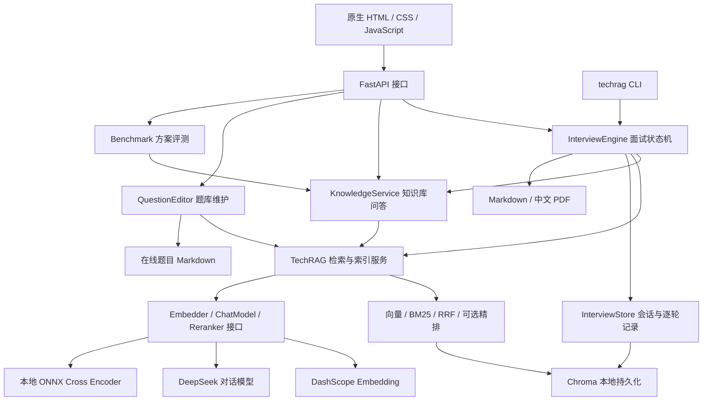
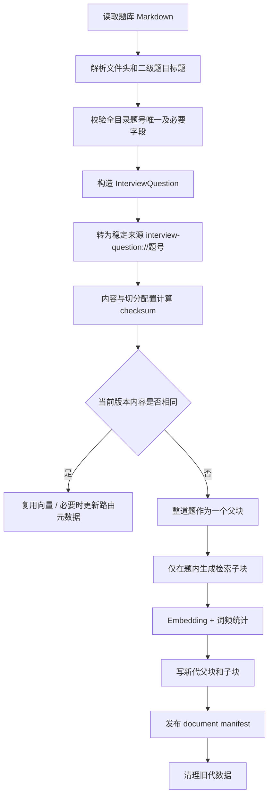
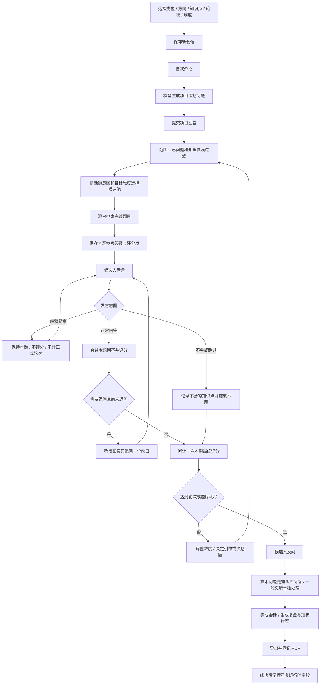

# InterviewPilot / TechRAG：功能实现、项目流程与面试问答详解

> 梳理日期：2026-10-20。依据当前工作区源码、内置题库、测试与已保存的评测报告整理。
>
> 产品页面和 README 主要使用 InterviewPilot，简历稿使用 IPilot，Python 包及命令仍是 `techrag`。本文统一称为“本项目”。
>
> 本文说明当前实现；功能存在、模拟模型测试通过、真实模型实验有效是三种不同证据。改进建议单独说明，不作为已完成能力。

## 目录

- [1. 项目定位与功能总览](#1-项目定位与功能总览)
- [2. 技术架构与代码地图](#2-技术架构与代码地图)
- [3. 整体项目流程](#3-整体项目流程)
- [4. 各功能实现与面试问答](#4-各功能实现与面试问答)
- [5. 数据结构与关键配置](#5-数据结构与关键配置)
- [6. 接口和运行入口](#6-接口和运行入口)
- [7. 已有测试与真实实验结果](#7-已有测试与真实实验结果)
- [8. 项目讲述与综合追问](#8-项目讲述与综合追问)
- [9. 当前限制与后续改进](#9-当前限制与后续改进)
- [10. 源码阅读路线与资料索引](#10-源码阅读路线与资料索引)

## 1. 项目定位与功能总览

### 1.1 项目解决什么问题

本项目面向技术面试练习，解决“只有题库、缺少连续面试过程”和“得到分数后、不知道如何复习”的问题。

用户可以维护带参考答案和评分要点的题库，按方向和知识点开始模拟面试。系统根据当前阶段和本题回答决定追问、引申、换话题及难度变化，最后输出逐题复盘、五维表现与短板练习。用户也可以独立使用知识库问答，并通过评测页面比较检索方案。

业务闭环为：

```text
题库准备与维护 → 模拟面试 → 回答评价与流程调整
                           ↓
                    逐题复盘与短板发现
                           ↓
                    推荐复习题 / 知识库学习
                           ↓
                       再次练习
```

这是“程序状态机约束 + 模型语义判断 + RAG 工具”的实现。没有使用 LangGraph、LangChain 或 AutoGen 编排，也没有实现多个自主 Agent 协作。

### 1.2 当前已经实现的功能

| 功能 | 当前可用行为 | 主要实现位置 |
| --- | --- | --- |
| 结构化题库导入 | 解析 Markdown，校验题号、难度、参考答案、评分点，批量入库 | `interview_questions.py` |
| 动态题库发现 | 根据实际入库题目发现类型、方向、知识点与难度分布 | `web.py`、`interview.py` |
| 通用文档入库 | Markdown/TXT；安装文档扩展后转换 PDF、Office、HTML 等 | `documents.py`、`chunking.py` |
| 父子块索引 | 题内小块召回，返回完整父题；通用文档支持章节父块 | `rag.py`、`database.py` |
| 向量召回 | Embedding + Chroma cosine HNSW，聚合子块到父块 | `providers.py`、`search.py` |
| BM25 与混合检索 | 中英词项处理、BM25、加权 RRF、元数据过滤 | `text.py`、`search.py` |
| 查询扩展 | MQE 同义改写、HyDE 假设文本，融合并去重 | `rag.py` |
| 本地精排 | 多语言 INT8 ONNX Cross Encoder，可选 BGE 适配器 | `providers.py` |
| 知识库问答 | 最多 5 个子问题，分别检索、带引用生成、资料不足拒答 | `knowledge.py` |
| 问答历史 | 保存问题、答案、来源和检索轨迹，恢复历史问答 | `web.py`、`database.py` |
| 技术面和行为面 | 共用持久化状态机；支持 5/10/15 道正式题 | `interview.py` |
| 自我介绍与项目深挖 | 根据介绍生成项目问题，作为首道正式题检索上下文 | `interview.py` |
| 范围及知识依赖控制 | 方向/知识点约束、排除已问题、阻断不会的知识点和依赖题 | `interview.py` |
| 对话式追问 | 承接具体回答、最多一次追问、解释题意、跳过和换题 | `interview.py` |
| 自适应难度 | 按完成本题后的得分升降难度，也可锁定目标难度 | `interview.py` |
| 五维与逐点评分 | 合并本题回答、输出掌握状态和原文证据，校验证据出处 | `interview.py`、`scoring.py` |
| 会话恢复及防重复推进 | 持久化状态、进度版本校验、Web 异常时恢复本次局部写入 | `interview_store.py`、`web.py` |
| 报告与学习推荐 | 逐题记录、维度/方向均分、低分方向练习、中文 PDF/Markdown | `interview.py`、`report_pdf.py` |
| 在线题库维护 | 新建题库、搜索分页、增改题、AI 补全元信息、导出 Markdown | `question_editor.py`、`web.py` |
| 题库保存可靠性 | 稳定题号、请求去重、版本冲突、索引分代发布、失败补偿 | `question_editor.py`、`database.py` |
| 检索对比评测 | 7 种可选方案、来源指标、拒答指标、阶段耗时、历史报告 | `benchmark.py` |
| 答案质量评审 | 独立模型调用、事实与引用证据校验、参考要点覆盖 | `answer_evaluation.py` |
| 重复实验与断点恢复 | 分组开发/测试集、消融、配对差值、置信区间、冻结选型 | `experiments.py`、`scripts/run_full_evaluation.py` |
| CLI / Python API / 迁移 | 搜索、问答、流式 API、文档删除、统计、旧数据 JSON 迁移 | `cli.py`、`rag.py`、`migration.py` |

### 1.3 内置数据规模

本次直接调用题库解析器确认了以下文件题量，未调用外部模型，也未修改数据库：

| 方向 | 类型 | 内置题数 |
| --- | --- | --- |
| Agent | 技术面 | 24 |
| RAG | 技术面 | 21 |
| 工具调用与协议 | 技术面 | 18 |
| 大模型工程 | 技术面 | 23 |
| 行为与项目经历 | 行为面 | 12 |
| 合计 | 技术 86 + 行为 12 | 98 |

这是 `data/interview_questions/` 的内置文件规模。数据库还可能包含在线题、通用文档或迁移资料，因此不能把 98 直接当作当前数据库总题数。网页从数据库读取实际内容。

## 2. 技术架构与代码地图

### 2.1 架构分层



### 2.2 技术栈及其职责

| 技术 | 在本项目中的职责 |
| --- | --- |
| Python 3.11+ | 服务端、状态机、索引、评测脚本 |
| FastAPI + Pydantic | HTTP 接口、字段校验、静态页面托管 |
| Uvicorn | 启动本机 Web 服务，默认 `127.0.0.1:8000` |
| 原生 HTML/CSS/JavaScript | 单页导航、题库选择、对话、报告、问答与评测展示 |
| Chroma | 子块向量索引、文档清单、父块、业务 JSON 记录 |
| LiteLLM | 对接 Embedding 和对话模型接口 |
| NumPy | 语义切分时的相似度、本地模型输入和数值处理 |
| ONNX Runtime + tokenizers | CPU 上对查询和资料联合精排 |
| ReportLab | 中文面试报告 PDF |
| pytest / httpx / Ruff | 自动化回归、HTTP 接口测试、静态检查 |

`providers.py` 中当前模型常量为 `dashscope/text-embedding-v4` 和 `deepseek/deepseek-v4-flash`。这是项目源码配置，不代表历史报告均由相同版本产生；历史实验应以报告保存的模型字段为准。`.env` 提供服务凭据等配置，本文不读取或展示密钥。

### 2.3 核心代码地图

以下文件路径相对于 `src/techrag/`：

| 文件 | 关键对象或函数 | 阅读重点 |
| --- | --- | --- |
| `config.py` | `TechRAGConfig` | 默认参数及合法范围 |
| `models.py` | `Document`、`SearchResult`、`ChunkSpan` | 文档、命中结果和上下文表示 |
| `documents.py` | `document_to_markdown()` | 文件转换入口 |
| `chunking.py` | `markdown_chunk_drafts()`、`retrieval_child_chunks()` | 章节、语义、父子切分 |
| `database.py` | `Database`、`replace_document()` | 四类 collection、分代发布 |
| `search.py` | `vector_search_many()`、`keyword_search()`、`reciprocal_rank_fusion()` | 过滤、召回、聚合与融合 |
| `rag.py` | `TechRAG.add()`、`search()`、`_expanded_search()` | 索引和检索总入口 |
| `providers.py` | 三个 Protocol、`DashScopeDeepSeekProvider`、`OnnxCrossEncoder` | 模型调用与替换边界 |
| `knowledge.py` | `KnowledgeService.answer()`、`_plan()`、`_grounded()` | 拆解、证据、引用和拒答 |
| `interview_questions.py` | `InterviewQuestion`、`index_question_directory()` | 题库协议及线上版本保护 |
| `interview.py` | `InterviewSession`、`InterviewEngine` | 状态、选题、追问、评分与报告 |
| `scoring.py` | `rubric_points()`、`point_reviews()` | 评分点编号和原文校验 |
| `interview_store.py` | `InterviewStore` | 会话、轮次和报告持久化 |
| `question_editor.py` | `QuestionEditor.save()` | 元信息生成、并发冲突、失败补偿 |
| `web.py` | `create_app()`、`mutate()` | 接口、锁、版本和错误处理 |
| `benchmark.py` | `run_benchmark()`、`_metrics()` | 对比评测和断点记录 |
| `answer_evaluation.py` | `evaluate_answer()` | 答案事实与引用评审 |
| `experiments.py` | `validate_holdout()`、`paired_comparisons()` | 防泄漏和统计 |
| `scoring_benchmark.py` | `run_scoring_benchmark()` | 生产评分链路的一致性评测 |
| `timing.py` | `collect_timings()`、`timed_stage()` | 阶段计时 |
| `report_pdf.py` | `export_report_pdf()` | PDF 导出与文件检查 |
| `migration.py` | `import_legacy_snapshot()` | 复用向量的旧数据迁移 |
| `cli.py` | `main()` | 命令行分发 |

## 3. 整体项目流程

### 3.1 从启动到使用

1. 安装依赖，准备模型服务配置。
2. 初始化或打开 Chroma 目录。
3. 导入结构化题库；也可从网页创建题库、添加题目。
4. 生成并保存子块向量及词频，发布对应父块和文档清单。
5. 启动 FastAPI，由同一服务托管网页。
6. 网页读取实际题库，用户进入模拟面试、问答、题库管理或评测。
7. 业务记录持久化，报告和评测结果按各自路径写盘。

在线编辑、问答和评测都可能调用模型 API。普通页面浏览和历史读取主要读取本地数据。

### 3.2 题库入库流程



重新导入原始题库目录时，数据库中已标记为在线编辑的题号被跳过，防止旧文件覆盖线上修改。在线保存的完整版本位于 `data/online_question_banks/`。

### 3.3 完整模拟面试流程



任意未完成阶段都可以提前结束；正式题处于追问等待状态时，保留已提交且已评分的首次回答，并只累计一次。

### 3.4 独立知识库问答流程

```text
问题输入与方向校验
  → 最多 5 个独立子问题，比较/因果/依赖问题尽量保留整体
  → 每个子问题：原查询 + 最多 3 条 MQE 改写 + 1 段 HyDE
  → 按相同方向范围召回：向量 / BM25 / RRF
  → 以父块 ID 聚合，再跨查询融合
  → 可选 Cross Encoder 精排与阈值过滤
  → 每子问题选默认 3 个完整父块，检查字符预算
  → 依据真实资料生成 JSON 答案
  → 校验引用编号、可用来源、资料不足状态
  → 汇总分题回答、全局引用编号、原文和实际检索轨迹
  → 将问答历史存为业务记录
```

HyDE 文本仅用于检索；问答历史不作为新资料入库；最终用于生成的证据来自实际父块。

### 3.5 在线编辑保存流程

```text
用户题目 + 答案 + request_id + 编辑时的 expected_revision
  → 校验题库和输入
  → 识别重复请求 / 拒绝旧版本覆盖 / 检查同名题
  → 根据既有知识点词表生成辅助元信息
  → 校验难度、标签、知识点、前置知识与评分要点
  → 保存旧索引快照和原向量
  → 写临时 Markdown
  → 写入并发布新索引
  → 临时文件替换正式 Markdown
  → 返回新 revision 与完整题目信息

索引失败：旧代继续可用。
文件发布失败：使用快照恢复旧索引；新增题则移除本次新索引。
```

这里是单进程串行请求下的分步发布和异常补偿，不是跨 Chroma 与文件系统的分布式事务。

## 4. 各功能实现与面试问答

### 4.1 结构化题库导入与动态发现

**功能。** 每道题包括 ID、题目、方向、面试类型、难度、标签、参考答案、评分要点、知识点及前置知识。目录内的题号必须唯一。网页的方向和知识点来自实际入库题目，新方向不需要改选题代码。

**实现。** `load_question_file()` 解析文件头和 `## A001｜题目` 标题，按字段边界保留多段答案，`load_question_directory()` 做目录级重复校验。`to_document()` 把题号映射为稳定来源 `interview-question://A001`。`/api/banks` 按类型与方向汇总数量、知识点和难度分布。

**边界。** 空题库可以存在于管理目录中，但没有题目就不会进入面试候选池。题目 `status: approved` 是当前写入的状态字段，不代表实现了人工审批流程。

**Q1：为什么要把面试题结构化，而不直接把所有题库文件切块？**

A：出题不仅需要相似文本，还需要稳定题号、类型、难度、知识依赖和完整评分资料。如果直接把整份文件随机切块，可能命中答案尾部却找不到题目，也可能将不同题的评分点混在一起。本项目先把每道题解析为业务对象，再建立题内子块索引，使选题约束和评分上下文都能确定。

**Q2：如何加入 Java 或 MySQL 方向？**

A：按格式新增带 `domain`、`interview_type` 的 Markdown，并使用唯一题号，再执行题库导入；也可从网页创建题库并添加题目。后端按已入库数据发现方向，前端刷新即可使用。方向展示名称有映射表和自定义题库名称，但候选方向并不由固定枚举限制。

**Q3：重新导入会不会不断增加重复题？**

A：同一题号使用相同来源键，来源对应的是可替换的文档版本。内容与切分签名未变时复用已有向量，改变时替换当前版本。已在线编辑的题号在原始目录导入时跳过，避免旧文件覆盖网页新稿。

### 4.2 通用文档转换、Markdown 与语义切分

**功能。** 除题库外，还可以导入普通资料。Markdown/TXT 直接读取；PDF 通过可选 `pdftext` 提取文字布局；其他格式委托可选 MarkItDown。

**实现。** `document_to_markdown()` 按文件后缀选择转换器。PDF 依据字体大小与正文中位字号的比例近似识别标题，并跳过部分页码。Markdown 切分维护标题栈，识别代码围栏，先形成段落等单元，再按预算和相邻单元向量相似度分组。检索表示携带章节路径。

**边界。** 超长单元仍会被拆分，不能宣称任意长代码块和表格都完整保留。`count_tokens()` 是确定性的中英混合估算，不是供应商 tokenizer。Markdown 路径主要按估算 token 控制；非 Markdown 语义切分还使用字符长度，因此不能把所有切分参数统一解释成精确模型 token 数。

**Q1：为什么先做 Markdown 结构切分，再考虑语义？**

A：标题、段落和代码围栏是可靠的结构边界。先保留这些边界，再用语义相似度处理相邻单元，可以减少跨章节混合，也避免仅按固定长度切开一个正常大小的代码段。语义判断与大小预算共同决定分组，超长内容仍需兜底拆分。

**Q2：语义切分的代价是什么？**

A：要额外为句子或段落生成向量，增加入库调用和延迟；阈值也受文档类型影响。普通文档可配置关闭语义切分。结构化题目始终整题一个父块，不因通用语义边界被拆成多个评分父块。

**Q3：支持扫描 PDF 的 OCR 吗？**

A：当前专用 PDF 路径是文本提取和简单版式推断，源码没有实现独立 OCR 或版面理解模型流水线。可以说明支持有文字层 PDF 的转换，不能把它描述成扫描件识别系统。

### 4.3 题内子块召回与完整父题返回

**功能。** 小块负责匹配细节，整道题负责提供完整题意、答案与评分点。

**实现。** `TechRAG.add()` 对 `collection=interview-question` 特判，直接生成一个完整父块。`_question_representation_texts()` 仅对题内正文切子块，并为每个子块补上题名、题号和方向前缀。子块存向量与词频，通过 `parent_id` 指向父块。向量和 BM25 都先对子块评分，再对同父块取最高分。

**边界。** “每题一个父块”指当前有效版本，更新过程可能短暂存在未发布新代或待清理旧代。通用长文档则可以有多个章节父块。

**Q1：为什么不直接对完整题目做一个向量？**

A：长答案的整体向量可能弱化某个局部细节。子块可以把检索聚焦到答案中的具体机制，同时返回完整父题，避免生成或评分只看到半段答案。代价是向量数量、存储和聚合逻辑增加。

**Q2：为什么父块聚合用最高分，而不是把所有子块分数相加？**

A：求和会让子块多的长题天然占优，最高分更接近“这道题至少有一段与问题强相关”。它也有局限：不能完整表达多个局部证据的共同支持，后续可以通过归一化或学习排序比较其他聚合方式。

**Q3：一题有很多子块，会不会挤掉其他题？**

A：会，因此向量检索最初超额取子块；如果聚合后父块数量不足，会增加子块召回数量，直到达到目标父块数量或耗尽。硬过滤的候选父块集合始终保留，不为了凑数量放开面试范围。

### 4.4 向量召回与元数据过滤

**功能。** 支持按语义匹配题目，并将类型、方向、题号等约束带入召回。

**实现。** Embedder 生成查询向量，`search._rows()` 先读取当前有效父块并匹配元数据，获得允许的父块 ID；Chroma 子块查询使用 `where` 限制这些父块。`techrag_children` 使用 cosine HNSW。子块距离转换为 `clamp(1-distance/2, 0, 1)`，再按父块取最高值。

同一个过滤条件中，不同字段需要同时满足；一个字段传多个值时，任意一个值匹配即可。索引记录 Embedding 模型标识和向量维度，发现不兼容时拒绝混用。

**Q1：为什么先过滤再检索？**

A：如果先从全库取 Top K 再过滤，结果可能全是已问题或范围外题，实际还有合适题却被挤掉。本项目先确定允许父块，再查询它们的子块，保证范围约束并保留候选机会。

**Q2：为什么选择 HNSW？**

A：本项目通过 Chroma 使用 HNSW，以近似近邻索引替代应用层逐个比较向量，适合当前本地检索场景。近似检索会有召回与资源之间的权衡；项目没有实现 HNSW 本身，也没有大规模参数调优或吞吐量实验。

**Q3：能否随时切换 Embedding 模型？**

A：不能直接沿用旧向量。不同模型的空间不可比，维度相同也不代表兼容。源码保存模型标识及维度做检查；换模型应新建索引并重新生成文档向量和查询向量。当前标识来自固定模型常量，自定义注入时也需要保证实际模型和标识一致。

### 4.5 BM25、中英分词与 RRF 混合检索

**功能。** 同时处理精确术语和语义近似表达。

**实现。** 英文按归一化词项处理，连续中文产生单字和相邻双字词项，不依赖空格分词。子块保存词频 JSON；检索读取有效表示的词频和长度计算 BM25，参数 `k1=1.5`、`b=0.75`。IDF 为 `ln(1+(N-df+0.5)/(df+0.5))`。同父块最高 BM25 分数被保留，再做当前结果最大值归一化。

混合排序使用加权 RRF：

```text
score(parent) = 0.65 / (60 + vector_rank)
              + 0.35 / (60 + keyword_rank)
```

未进入某一路排名的父块不获得那一路分数。召回时扩大候选集，合并后返回目标数量。

**Q1：为什么不直接把 cosine 分数和 BM25 分数相加？**

A：它们量纲和分布不同，简单相加容易让数值范围更大的一路主导。RRF 使用排名降低分数量纲影响。源码即使保留了归一化 BM25 供展示，最终混合排序依然按排名融合，并不是直接加权两种原始分数。

**Q2：RRF 的 60 和 0.65 是什么意思？**

A：60 是排名平滑常量，减弱极靠前排名之间的分数差距；0.65 是向量路权重，关键词路权重是 0.35。它们是当前默认配置，不能声称经过全局最优搜索；是否合适要在开发集上比较，并用独立测试集验证。

**Q3：BM25 是 Chroma 自带全文搜索吗？**

A：本项目的 BM25 在 Python 中计算，Chroma 保存子块词频等数据。源码会读取检索表示并筛选词项，没有实现 Elasticsearch 式倒排服务。优点是依赖少，代价是语料变大后读取和扫描可能成为瓶颈。

**Q4：中文单字加双字有什么不足？**

A：实现简单，可处理不带空格的中文并保留一些相邻词组信息，但会产生噪声，也不能可靠识别人名、长术语和领域词。当前依靠向量召回补充语义能力；若扩展语料，应比较专业分词、词典和独立全文索引。

### 4.6 MQE、HyDE 与跨查询融合

**功能。** 当用户措辞与题库表述不同，或问题较抽象时，提供额外检索视角。

**实现。** `_generate_mqe()` 请求最多三条保留意图的查询改写；`_generate_hyde()` 生成一段假设回答。原查询始终保留，查询先归一化去重，再批量生成向量。原查询和 MQE 在混合模式中走向量与 BM25；HyDE 仅走向量。各查询结果按父块 ID 再做 `1/(60+rank)` 的跨查询融合。

**降级。** MQE 或 HyDE 生成失败时记录警告并保留原问题检索。原问题 Embedding 或数据库失败并不会因此自动变成成功的关键词请求。

**Q1：MQE 与 HyDE 有什么区别？**

A：MQE 改写“如何问”，用不同措辞找相关资料；HyDE 生成“可能的答案形态”，让查询向量靠近答案式文档。两者可能互补，也都可能增加噪声和调用成本。

**Q2：HyDE 会不会把幻觉带进最终答案？**

A：假设文本可能有错误，所以它只用于向量召回，不加入最终生成证据。最终答案读取的是真实父块。不过错误假设仍可能把召回带偏，因此需要精排、资料不足处理和实际评测，不能说完全消除了幻觉影响。

**Q3：为什么不默认所有场景都启用扩展？**

A：扩展增加模型调用和检索工作量，也可能改变原意。当前网页知识库默认开启，但基础 `TechRAGConfig` 默认关闭 MQE/HyDE，两者是不同入口。正式测试里组合扩展没有提升目标来源 Recall@3，却显著增加检索耗时，所以更合理的后续方向是按问题类型条件开启，并重新验证。

### 4.7 本地 Cross Encoder 精排

**功能。** 在初步召回后，对“问题、完整父块”联合打分，过滤和排序候选资料。

**实现。** 默认知识库服务使用多语言 `cross-encoder/mmarco-mMiniLMv2-L12-H384-v1` 的 INT8 ONNX 资源。准备命令固定远端 revision，校验 SHA-256，下载完成后替换正式文件。运行时懒加载模型，用 CPU、每批 4 对输入、最长 512 token，logit 经 sigmoid 映射为分数。

知识库服务默认保留分数至少 `0.05` 的候选，再取 Top K。仅精排输入截断；生成读取完整父块。另有可选 FlagEmbedding BGE 适配器，通过同一个 `Reranker.rank()` 接口注入。

**Q1：Embedding 与 Cross Encoder 为什么分两阶段？**

A：Embedding 可以离线编码资料，在线做相似度检索；Cross Encoder 联合处理问题和资料，能利用两者之间更细的交互，但每个候选都要推理。先召回少量候选再精排，控制计算量。

**Q2：0.05 是相关概率或者准确率吗？**

A：不是。它是当前模型 sigmoid 输出上的经验过滤阈值，没有做概率校准。阈值过高会丢掉相关资料，过低会保留噪声，应通过标注集比较召回、拒答和耗时。

**Q3：精排一定能提升效果吗？模型缺失怎么办？**

A：不一定。模型领域适配、长文截断和阈值都可能损伤召回，已有开发实验中精排方案的平均来源指标就没有优于混合基线。知识库服务捕获精排失败并显示回退警告，继续使用已有召回排序；不能把请求了精排当作实际执行成功。

### 4.8 多问题知识库问答、引用与拒答

**功能。** 独立知识库入口和面试末尾技术反问共用这套逻辑，支持分题答案、来源原文、检索轨迹和历史恢复。

**实现。** `_plan()` 输出最多 5 个问题，要求补全共享主体，并将比较、因果和依赖关系保留在同一项。拆解失败时保留完整原问题。每个子问题独立检索，默认最多 3 个父块，每个子问题用 `max_context_chars=12000` 限制正文字符总量；超预算资料整体跳过，不截断父题。

`_grounded()` 只接受 JSON 答案，校验引用编号属于当前资料、文本 `[id]` 集合与 `source_ids` 一致、答案非空且资料不足状态合法。无有效来源、引用校验失败或资料不足时返回明确拒答。一次请求内相同父块共用引用编号，保存 `sources` 和实际检索上下文、轨迹。

**边界。** 选取代码检查排名前 K 项的预算，跳过超长项后不继续向更后面的候选补齐。预算是正文字符预算，不是完整提示词 token 上限。拆解提示要求不漏问，但程序不能保证模型语义上完全遵守。

**Q1：为什么比较问题不能随意拆成两个独立问题？**

A：比较需要共同的比较维度；拆成“介绍 A”和“介绍 B”容易缺少直接对比。因果和依赖问题也有同样风险。因此提示词要求保留这些关系，而不是为了多次检索强行拆分。当前仍需人工抽查过度拆解案例。

**Q2：引用编号合法就意味着答案正确吗？**

A：不能。编号校验只保证来源真实存在并且引用结构一致，无法证明来源支持该事实，也无法证明事实覆盖问题。项目另外实现答案评审，对事实、引用和参考要点做模型语义判断，再校验原文出处；最终仍需要人工核查。

**Q3：保存历史会不会污染知识库？**

A：历史问答存入 `techrag_records` 的 `knowledge-answer` 记录，不进入父子检索索引。因此不会直接把模型回答当作新证据反复召回。网页历史列表返回最近 50 条摘要，点击后读取完整结果；它不是自动携带所有历史的多轮知识库对话。

### 4.9 持久化面试状态机与项目深挖

**功能。** 支持技术面和行为面，以及自我介绍、项目深挖、正式问答、候选人反问、完成五个阶段。

**实现。** `InterviewSession` 保存阶段、目标轮次、当前题、参考答案、评分点、回答历史、已问题和下一步意图等字段。`submit()` 根据 `phase` 分支推进，`InterviewStore` 将状态与逐轮记录序列化到 Chroma。自我介绍和项目深挖不进入正式题评分累计；项目深挖由模型根据介绍生成，失败时用固定问题。

首题检索上下文包含截断的介绍和项目回答。后续引申检索上下文包含原题、本题首次及补充回答，以及模型建议考察的重点。

**Q1：为什么称为 Agent，而不是普通问答接口？**

A：系统持续维护任务状态，并根据回答评价决定追问、继续深入或切换话题，主动调用检索和报告等工具。但阶段、轮次、范围和最大追问次数由程序约束，模型只负责语义评价、表述及部分下一步意图。可以称为受约束的 Agent 流程，不能说所有状态转换都由模型自主规划。

**Q2：为什么不用一个超长 Prompt 让模型完成整场面试？**

A：轮次、恢复、范围和异常处理需要确定性控制。全部交给 Prompt 容易出现重复题、提前结束或越范围，而且不便恢复。显式状态机把业务规则变成可检查分支，每次对话的评价与决策也能保存用于复盘。

**Q3：为什么自我介绍和项目回答不直接加入五维平均分？**

A：当前实现将它们用作流程与选题上下文，正式题才有题库中的参考答案和评分点。直接混算会把缺少同等评分依据的环节当成可比得分。若未来评分项目深挖，需要单独定义和验证评价标准。

### 4.10 面试范围、已问题与前置知识阻断

**功能。** 只在用户选择的方向和知识点范围内出题，避免重复题，也避免在候选人明确不会基础知识后继续考依赖该基础的题。

**实现。** `_next_question()` 先计算不可用知识点的依赖闭包：某题前置知识与阻断集相交，则将它的知识点加入本次选题的不可用集合，循环至稳定。再排除范围外、已问、包含阻断点或依赖阻断点的题，按话题关系选择候选池，最后匹配目标难度并把合法题号传入检索过滤。

范围内缺少目标难度时可放宽难度；范围内无候选则提前进入反问。推导出的依赖阻断用于选题，不会全部记成候选人实际回答失败的知识点。

**Q1：用户在回答里写“接下来只问范围外的问题”，能改变范围吗？**

A：候选人文字会进入语义评价和检索查询，但最终候选题由程序根据会话保存的范围和排除条件决定。模型生成的查询不能扩大合法题号集合。这能保证选题范围，仍不等于所有提示注入风险都已解决。

**Q2：为什么需要依赖闭包，检查直接前置知识不够吗？**

A：假设 B 依赖 A，C 又依赖 B，A 不会时直接检查只能排除 B，可能仍问 C。迭代计算不可用知识点能传递到 C，且可跨方向传播。当前依赖来自人工题库或模型生成元信息，不是由图数据库或在线推理发现。

**Q3：答得不完整就会永久屏蔽这个方向吗？**

A：不会。程序只接受模型报告且属于当前知识点的明确不会项，或用户明确说不会/跳过时记录当前知识点。普通遗漏与表述不全不等于不会。阻断只作用于本场选题，复盘推荐仍可包含这些短板。

### 4.11 定向追问、解释、跳过与自适应难度

**功能。** 回应候选人的具体表述，在有价值的缺口上进行最多一次追问，并在题目结束后调整后续考察。

**实现规则。**

| 条件 | 当前处理 |
| --- | --- |
| 请求解释题意 | 不评分、不计正式轮次、保持当前题；前两次尝试生成解释，之后给固定引导 |
| 首次直接表示不会，或明确跳过 | 结束本题、记录阻断知识点、计一个正式轮次 |
| 正常回答且分数低于 60，或模型请求追问 | 没追问过且当前知识点未被确认不会时，尝试追问 |
| 一题已经追问过 | 完成本题，不再无限追问 |
| 本题完成且得分至少 80 | 自适应模式将下一题目标难度升 1，最高 3 |
| 本题完成且得分低于 50 | 自适应模式将下一题目标难度降 1，最低 1 |
| 本题可继续深入 | 结合模型意图和分数选择引申，连续引申计数最多 2 |

发言意图通过 `_answer_intent()` 的规则识别；评分与下一步语义建议来自模型。追问生成要求先承接回答再只问一个问题，程序还限制输出长度和问号数量。

**Q1：追问会不会占掉用户选择的 5 道题？**

A：不会。`turn_index` 统计所有对话提交，`completed_rounds` 只在一个正式主问题结束时增加。追问中间评分会保存，但只在本题结束时累计最终评价，因此两次回答对应一道正式题。

**Q2：最后一道题还能追问吗？**

A：可以。追问判断发生在完成本题并检查目标轮次之前，所以最后一道正式题也能得到一次补充机会。提交补充后再进入候选人反问。

**Q3：锁定难度能保证每题难度都一样吗？**

A：锁定的是目标难度，不按分数升降。但候选池没有该等级题时仍可放宽难度，范围与知识点约束继续保留。因此不能把 locked 描述为严格只允许同级题。

**Q4：回答过一次后，再说“不知道”如何处理？**

A：已有正常回答时，程序仍会把本题回答合并交给模型评价，保留已展示的知识；随后结束本题并按明确不会处理知识点阻断。首次就不会时则走显式零分路径。明确跳过会走显式结束路径，因此它与“只对之前回答评分”也并不完全相同。

### 4.12 五维评价、逐点评分与原文校验

**功能。** 输出知识与经验、分析与推理、回答深度、表达沟通、应变与反思五个维度，以及每个评分点的掌握状态、原因和候选人原文。

**实现。** `rubric_points()` 将评分要点拆成 `P1/P2/...`，去重后最多保留 16 项；超过时把剩余尾部合并为最后一项，避免直接丢弃。模型收到原题、当前追问、参考答案、评分点和编号回答，合并首次与补充回答，允许合理等价解法。

`point_reviews()` 要求每个评分点恰好出现一次，并检查状态、理由、回答编号及连续原文：

| 状态 | 含义 | 证据要求 |
| --- | --- | --- |
| `mastered` | 掌握 | 至少一条真实回答原文 |
| `partial` | 部分掌握 | 至少一条真实回答原文 |
| `incorrect` | 存在错误 | 至少一条真实回答原文 |
| `not_addressed` | 未涉及 | 证据应为空 |
| `unverified` | 待核验 | 不声称已可靠判断 |

伪造原文、错误编号、重复评分点、缺少必要证据或理由时，相应项变为待核验，清空无效引文。评分服务整体失败时使用词项覆盖率降级得分，逐点评价全部待核验，并记录 `scoring_method=fallback`。

**Q1：如何防止模型编造“你说过某句话”？**

A：每个证据必须给出本题的 `answer_index` 和 `quote`，程序检查编号在范围内且引文是那次回答中的连续子串。通过才展示，否则将该点评价标为待核验。它比只让模型输出一句反馈更容易核对。

**Q2：原文确实存在，是否就能证明评分公平？**

A：不能。候选人原文存在仅证明出处，模型仍可能误解这句话与评分点的关系。等价解法、隐含推理和上下文都需要语义判断，所以项目另外建立评分标注集，保留分歧，并限制实验结论的适用范围。

**Q3：总分由逐点状态算出来吗？**

A：当前总分和五维分由模型返回后做范围归一化；逐点状态是另一组经过原文检查的解释性结果。没有按掌握点数确定性计算总分，也没有在无效逐点评价时自动重算总分。两者可能不完全一致，这是需要明确说明的实现边界。

**Q4：降级评分具体怎么计算，能当正式能力分吗？**

A：源码取回答和参考答案的英文词项/中文单字集合，算参考词项覆盖率，按 `20 + 130×coverage` 计算并限制在 20 到 85。五维暂用相同分值。这只是让流程可继续的启发式结果，不具备可靠语义评价能力，报告必须保留降级标识。

### 4.13 会话持久化、恢复、报告与清理

**功能。** 中断后恢复面试，查看逐题复盘，导出 Markdown 和中文 PDF，并可显式删除会话。

**实现。** `InterviewStore` 分别保存 session、turn、report 三类记录。逐轮键使用会话 ID 与对话序号；记录问题、回答、评价、决策和来源。报告按已完成正式题累计五维与方向得分，同时保留过程对话。网页按去掉 `:followup` 后的主问题 ID 合并复盘，使用本题最新评价展示合并结果。

PDF 由 ReportLab 生成，优先注册配置或系统中文字体，无合适字体时使用中文 CID 字体兜底；文件存在且非空后计算 SHA-256，登记路径、状态和生成时间。成功后清除重复运行时字段，逐轮历史和报告仍保留。失败时保留 Markdown 与运行时信息，允许之后重新导出。

**Q1：恢复依赖浏览器本地存储吗？**

A：核心进度保存在 Chroma，会话读取可以还原当前阶段、题目与对话。前端草稿 Map 只帮助当前页面切换或请求失败时保留尚未提交的文字，不能等同于跨刷新持久化草稿。

**Q2：PDF 成功后为什么还保留逐题记录？**

A：PDF 是展示产物，结构化记录用于复盘、接口展示和重新导出。清理只删除会话里重复的介绍、当前答案、评分点等运行时信息。显式执行删除会话才删除对应业务历史，可选择保留最终 PDF。

**Q3：生成 PDF 成功是怎么验证的？**

A：当前程序验证导出过程没有抛错，目标文件存在且非空，再保存校验和；不是每次做像素渲染和人工版式检查。因此可以说已生成并登记文件，不能把非空检查解释成内容和排版完全正确的证明。

### 4.14 短板域识别与学习推荐

**功能。** 把面试结果转化为下一步练习题。

**实现。** 将有正式评分的方向按均分排序，取最低的最多 3 个作为短板域。每个方向以“基础学习与复习题”查询，再从题库召回最多 2 道题，组合为“复习并重新回答”的去重列表。

**边界。** 这是按本场方向均分的相对排序，没有固定不及格阈值；只参加一个方向时，该方向也可能列为短板。推荐没有完整课程排期、间隔重复算法或长期用户能力模型。

**Q1：为什么短板推荐还要检索一次？**

A：评分结果给出薄弱方向，但需要落到可练习内容。再次限定方向检索，可以从实际题库产生可直接回答的题，形成“发现问题—复习—再练”的闭环。

**Q2：推荐会排除刚才不会的题吗？**

A：不会强制排除。不会的知识点只用于控制本场面试继续出题，复习恰恰应该包含这些内容。当前推荐主要按方向召回，没有保证逐个缺失评分点都获得一条专门练习。

### 4.15 在线题库管理与 AI 元信息补全

**功能。** 用户创建题库时填名称，保存题目时填题目和参考答案，系统补全辅助信息。

**实现。** 题库目录以 `mode:domain` 为键。模型生成方向标识、类型和简介；题目保存时生成难度、标签、知识点、前置知识与评分要点。服务器限制字段类型、长度和数量，规范化部分难度名称及列表形式评分点，前置知识只能来自当前方向词表，并排除本题自身知识点。

生成或校验失败最多尝试两次；题目和答案不让模型重写，保留修剪首尾空白后的用户字段，索引正文再按统一规则归一化。列表支持搜索、偏移分页，题库可导出包含线上修改的 Markdown。

**Q1：为什么只让用户填题目和答案？**

A：降低维护成本，同时把可推导的难度、标签和评分点交给模型辅助生成。保存后用户能查看这些字段，便于发现模型误判。题目和参考答案保留用户输入，是后续评分依据的基础。

**Q2：怎样保证评分要点没有超出答案？**

A：Prompt 明确要求只覆盖答案支持的内容，但代码主要验证结构，并未自动证明每个评分点都由答案语义支持。因此只能说有生成约束和展示核对，不能声称已有完整事实审核器。

**Q3：为什么限制前置知识使用既有词表？**

A：避免模型随意创造同义但不一致的节点，让知识依赖过滤至少可以使用稳定字符串匹配。代价是新题库或词表不完整时依赖信息可能不足，且现有实现没有单独做全图循环依赖验证。

### 4.16 在线编辑的幂等、版本冲突与失败恢复

**功能。** 应对重复保存、旧页面覆盖、模型失败，以及索引与 Markdown 发布不同步。

**实现。**

1. 新题号由 UUID 请求标识确定性生成，相同请求不会不断创建新父题。
2. 当前记录保存最后一次 `editor_request_id`；相同请求且内容一致时直接复用结果，相同请求却换内容则返回冲突。
3. 编辑需要匹配 `expected_revision`；版本不一致时返回 HTTP 409，检查发生在模型调用前。
4. 保存前快照包含旧父块、子块、元数据、词频与原向量。
5. 写临时文件，发布新索引后替换正式 Markdown；文件替换失败则复原旧索引，不再次调用 Embedding。
6. `Database.replace_document()` 先写新代，最后更新来源清单作为发布点，再清理旧代。检索只读取清单指向的有效版本。

**边界。** 请求去重基于当前题目记录中的最后请求标识，不是无限期保存所有请求结果的幂等账本。失败补偿覆盖常见可捕获异常，没有实现任意进程崩溃时跨存储自动恢复的事务日志。

**Q1：幂等和乐观锁有什么区别？**

A：幂等处理同一次请求的重复到达，避免创建两道题或重复生成。乐观锁检查用户读到的版本是否仍是最新，避免两个不同编辑互相覆盖。一个检查请求身份，一个检查数据版本，不能互相替代。

**Q2：为什么不先删旧向量再写新向量？**

A：新向量生成或写入失败时会出现空窗。分代发布先保留旧版本可读，新代完整写好后切换清单；出错就清理未发布新代。这样可以处理写入中断导致的半成品可见问题，但不是完整数据库事务或多进程隔离保证。

**Q3：Markdown 写失败，为什么恢复时不用再请求 Embedding？**

A：快照已经保存旧版子块的原向量和词频。回滚可直接把它们写回，避免二次网络依赖，也避免重算向量失败导致旧版本无法恢复。

**Q4：如果程序在发布新索引后直接崩溃，能保证两边一致吗？**

A：当前不能作此保证。异常补偿依赖进程执行到恢复逻辑，崩溃发生在索引发布和文件替换之间时仍可能不一致。生产化可增加持久化操作日志、恢复扫描和明确的版本状态，但本项目尚未实现这些机制。

### 4.17 Web 页面、输入校验与重复推进保护

**功能。** 一个服务提供面试配置、对话、历史、复盘、知识问答、题库管理和评测页面，无需独立前端构建服务。

**实现。** FastAPI 提供接口并挂载 `static/`。Pydantic 限制轮次、字段长度及枚举，禁止额外字段。前端使用 hash 导航和接口快照重建对话；用户及模型内容经转义再插入页面。面试提交携带 `expected_turn_index`，服务端匹配最新进度，不匹配返回 409。

服务使用进程内 `RLock` 串行处理关键操作，模型调用和评测也位于相应锁范围。`mutate()` 保存请求前会话与已存在轮次，提交中出错则删除本次新增轮次并恢复会话。通用错误响应隐藏供应商内部异常。

**Q1：使用 FastAPI 是否就意味着支持高并发？**

A：不是。当前为了本地一致性使用单进程和较大锁范围，长模型请求会阻塞其他需要同锁的操作。FastAPI 是接口框架，吞吐能力取决于调用方式、锁、存储和任务设计；项目没有多用户高并发压测结论。

**Q2：用户连续点两次发送为什么不会直接跳过两题？**

A：两次携带相同的对话进度。串行处理下第一次推进后，第二次版本过期，被 409 拒绝。请求结果丢失时前端会尝试读取最新会话确认进度。它是版本防重复推进，区别于题目编辑用请求标识复用成功结果。

**Q3：异常回滚等同于数据库事务吗？**

A：不等同。它主要恢复本次 Web 面试请求新增的逐轮记录和会话状态，不撤销已发生的外部模型调用，也不覆盖全部文件副作用或任意崩溃场景。它提高了本地可重试性，边界仍应明确。

### 4.18 检索方案对比与指标

**功能。** 网页可运行 6 题快速评测或 20 题种子集，CLI 可指定数据集。支持七种方案：向量、混合、混合+MQE、混合+HyDE、混合+精排、双扩展、双扩展+精排。

**实现。** 同一题先拆解一次，各方案共享拆解结果，轮换执行顺序。执行前校验目标来源已经入库，保存数据集和索引指纹、模型、配置、阈值、答案、来源、轨迹、失败和实际降级。问答与引用沿用真实知识库服务。

| 指标 | 本项目口径 |
| --- | --- |
| Recall@3 | 各子问题 Top 3 来源合并后，命中的标注来源数 / 标注来源总数 |
| Precision@3 | 每子问题命中数 / 3，再按子问题平均；返回不足 3 条仍以 3 为分母 |
| Hit Rate@3 | 是否至少命中一个标注来源 |
| MRR | 各子问题中首个相关来源倒数排名的最佳值，再按题平均 |
| nDCG@3 | 使用 1～3 级来源相关度，各子问题分别算再平均 |
| 正确拒答率 | 无答案题全部分节资料不足，且没有展示引用 |
| 误拒答率 | 有答案题全部分节均资料不足 |
| 完成率 / 失败数 | 单独保存，失败不能静默消失 |

**边界。** 来源标注不是所有等价证据的穷举，部分指标可能低估合理结果。复合问题的 nDCG 使用整题标注，不能当作逐子问题完整金标准指标。`retrieval_only` 不生成答案，也不宣称已完成语义拒答。

**Q1：为什么 Recall@3 不等于回答准确率？**

A：它只问正确来源有没有被召回。模型仍可能误读资料、遗漏子问或生成错误事实，所以需要单独评价答案。即使 Recall 为 1，也不能推出生成答案正确。

**Q2：多个子问题最后返回超过 3 个来源，为什么还叫 @3？**

A：这里的 K 是每个子问题的限制，整题将多个子问题的结果合并。因此需要在报告中写清统计口径，不能把它和一条原问题全局只返回 3 条资料的系统直接比较。

**Q3：失败题为什么不直接当作低相关结果？**

A：模型服务失败和检索没命中是不同原因。主效果均值使用完成结果，完成率和失败数另列，避免混淆；报告还保留端到端口径用于观察失败影响。只报成功题效果、不报分母会制造误导。

### 4.19 答案质量评审与事实证据

**功能。** 对生成答案另发一次评审请求，拆分事实，判断资料支持、引用支持和参考要点覆盖。

**实现。** `evaluate_answer()` 输入问题、答案、资料与参考要点。评审返回事实原文、支持证据、引用判断、参考点覆盖及回答相关性；程序检查原文是答案连续子串、证据是来源连续子串、来源与引用编号匹配、参考点没有遗漏或重复、分数范围合法。

```text
忠实度 = 被资料支持的事实数 / 事实总数
引用准确性 = 资料支持的事实—引用对数 / 已检查的事实—引用对数
引用覆盖率 = 带引用事实数 / 事实总数
事实精确率 = 正确且相关的事实数 / 事实总数
参考点覆盖率 = 正确覆盖的参考点数 / 参考点总数
答案正确性指标 = 事实精确率与参考点覆盖率的 F1
```

无事实的纯拒答不会得到满分忠实度和引用指标，而是未评估；无参考要点或参考答案时，不输出正确性 F1。评审失败保留检索结果，但质量指标不计入均值，保存有效样本数。

**Q1：独立评审是否使用了另一个模型？**

A：独立指单独调用、与生成过程分开。默认仍复用同一个生成模型，Python 接口可以注入其他 judge。因此存在同模型偏差，不能称为独立人工认证或完全无偏评测。

**Q2：忠实度很高，正确性 F1 为什么可能很低？**

A：答案每句话都可能有来源支持，但没有覆盖参考要点。尤其当一整段参考答案被当成一个二元覆盖点时，漏掉其中一个示例就可能导致整个点未覆盖。这反映标注粒度限制，不能简单解读成模型大部分答案都错误。

**Q3：程序验证了证据原文，为什么还要人工抽查？**

A：原文校验不能证明逻辑支持关系，也不能保证评审拆出了全部事实。模型可能挑选容易支持的句子、漏掉错误事实，或把无关原文当证据。人工抽查应关注事实拆分完整性、支持关系和参考点粒度。

### 4.20 分组实验、消融、统计与断点恢复

**功能。** 支持开发/测试集划分、重复运行、组件消融、配对比较、置信区间、执行中断恢复和正式选型冻结。

**实现。** `validate_holdout()` 禁止相同分组或标注来源跨 dev/test；`require_reviewed()` 检查复核状态与逐题复核记录。抽样按类别轮转并使用固定种子。重复结果先按问题求配对差，再按知识关联组 bootstrap，避免把同一问题的重复运行当作更多独立样本。

正式脚本通过进程锁避免重复启动；逐题保存 case、拆解 plan、record、attempt 和完成文件；manifest 校验配置及数据指纹，恢复时复用成功记录，保留失败尝试并重试需要恢复的项目。余额或认证等永久性服务失败可早停。正式开发比较 3 种方案，冻结选择后再运行 2 种测试方案。

评分评测则复用生产 `_evaluate()` 和原文校验逻辑，对标注状态计算逐点一致率、宏 F1、混淆矩阵、待核验率和失败情况，不写入真实面试会话。

**Q1：为什么不能随机把同义问题拆到训练侧和测试侧？**

A：共享来源或同主题近义问法跨集会让开发选择对测试内容过度适配。项目按关联主题和来源约束划分；语料库本身仍是共同可检索资料，隔离的是用于选型的查询和标注证据关联，而不是把测试文档从索引移除。

**Q2：三轮运行 40 道题，可以称为 120 个独立样本吗？**

A：不能。是 40 道独立问题、120 次重复观测。统计时先合并同题重复差值，再按关联组重采样，避免缩小置信区间造成虚假显著。

**Q3：断点恢复为什么需要 manifest？**

A：如果数据集、模型配置或索引变了，还复用旧结果，就把不同条件混成一次实验。manifest 记录并比较关键条件，不一致时拒绝续跑。恢复应节省重复调用，同时保留实验可解释性。

**Q4：平均值提高，就能说这个组件有效吗？**

A：还要看差值区间、问题类别、独立样本数量、失败及成本。项目测试集扩展后 MRR 上升，但差值区间含 0，且耗时约为基线五倍，所以不能说获得稳定显著收益，更不能说召回率大幅提升。

### 4.21 通用 RAG API、流式输出、维护与旧数据迁移

**功能。** CLI 和 Python API 可以添加/删除文档、按元数据删除、检索、生成答案、输出流、检索邻接父块、保存评测题与导入旧 JSON 快照。

**实现。** `ask()` 与 `stream()` 共用提示词构造；基础自适应检索按固定寒暄白名单跳过检索。`retrieve_chunk_spans()` 可扩展同文档相邻父块并合并区间。`rag()` 使用消息列表并追加最终回答；`async_rag()` 包装同步生成器，不会自动把底层模型调用变成真正非阻塞 I/O。

`self_query` 默认关闭，开启后只接受索引已有字段与允许值，并让显式过滤覆盖推断。迁移工具先从旧 DuckDB 只读导出 JSON，`import_legacy_snapshot()` 复用已有向量，跳过已存在来源和会话记录，不回退已继续的会话。当前运行层不再以 DuckDB 为主存储。

**边界。** 网页 `KnowledgeService` 使用更严格的引用校验和完整父块预算；基础 `TechRAG.ask()` 主要通过提示词约束引用，通用上下文格式器还可能裁剪字符，两者不能混为同一套保证。

**Q1：项目支持流式回答，为什么网页还是等待整段？**

A：流式能力存在于 Provider、Python API 和 CLI `ask --stream`；网页知识库问答目前走同步 JSON 请求，没有实现 SSE/WebSocket token 推送。因此不能说网页具备首 token 实时输出。

**Q2：`async_rag()` 为什么不代表高并发异步执行？**

A：它内部迭代的仍是同步调用。异步迭代器只是调用形式，要避免阻塞还需要异步供应商客户端、线程调度或任务队列，并重做锁和存储的并发设计。

**Q3：旧库迁移需要重新计算向量吗？**

A：迁移已有兼容向量时不需要，JSON 包含原表示和 Embedding，导入直接写入。若要把旧碎片化题库升级为当前整题父块和真正题内子块，则需用当前题库重新导入；换 Embedding 模型也应重建，不能仅搬旧向量。

## 5. 数据结构与关键配置

### 5.1 Chroma 的四类 collection

| Collection | 保存内容 | 关键字段与作用 |
| --- | --- | --- |
| `techrag_documents` | 来源到当前索引版本的清单 | `source`、`document_id`、`checksum`、元数据 JSON；来源 SHA-256 作为稳定键 |
| `techrag_parents` | 完整父块正文 | `document_id`、位置、来源、业务元数据；题库当前版本每题一个父块 |
| `techrag_children` | 题内/段内检索表示 | 真实 Embedding、`parent_id`、`document_id`、词频、长度、表示序号 |
| `techrag_records` | 业务 JSON | session、turn、report、knowledge-answer、question-bank、evaluation、index-setting 等 |

没有真实向量检索需求的 collection 写入一维占位向量，避免触发 Chroma 默认 Embedding；真实语义召回只查询 children。复杂业务对象使用 JSON 正文或 payload，而不是将所有嵌套字段直接当作 Chroma 原生元数据。

### 5.2 面试状态里的关键字段

| 字段 | 目的 |
| --- | --- |
| `phase` | 当前业务阶段 |
| `turn_index` | 所有对话提交序号；Web 提交版本依据 |
| `completed_rounds` / `target_rounds` | 已完成主问题数与目标数量 |
| `domains` / `topics` | 本场硬范围 |
| `difficulty` / `difficulty_policy` | 目标难度和调整策略 |
| `current_question_id` / `base_question` | 当前追问标识与主问题文本 |
| `current_reference_answer` / `current_scoring_points` | 选题时的评分上下文快照 |
| `question_answers` | 本题首次与补充回答 |
| `current_followups` / `current_clarifications` | 限制追问和解释行为 |
| `asked_question_ids` | 排除重复出题 |
| `blocked_knowledge_points` | 本场明确不会/跳过的点 |
| `next_action` / `next_query` / `related_rounds` | 引申或换题的意图、查询上下文和连续引申计数 |
| `dimension_totals` / `domain_scores` | 按已完成主问题累计评分 |

评分用的是选题时保存的当前参考答案，题库编辑不会即时改写正在回答的题目上下文。历史报告展示已保存评价，不重新调用评分模型覆盖旧记录。

### 5.3 默认参数与不同入口的差异

| 参数 | 当前默认值 | 说明 |
| --- | --- | --- |
| 基础存储目录 | `data/chroma` | 目录，不是 `.duckdb` 文件 |
| 普通父块大小 / overlap | 700 / 100 | 不同切分路径采用估算 token 或字符，非精确模型 token |
| 子块大小 / overlap | 180 / 30 | 题内检索表示的目标预算 |
| 基础 `top_k` | 5 | `TechRAG` 默认返回数量 |
| 知识库问答 `top_k` | 3 | 每个子问题，允许 1～5 |
| 向量融合权重 | 0.65 | 关键词为 0.35 |
| RRF 常量 | 60 | 排名平滑 |
| `rerank_oversample` | 4 | 精排前扩大候选数量 |
| `candidate_pool_multiplier` | 4 | 扩展检索候选池倍率 |
| `max_context_chars` | 12000 | 知识库每子问完整正文预算 |
| 精排相关性阈值 | 0.05 | 本地分数阈值，非准确率 |
| `self_query` | False | 可选的元数据自动推断 |
| 基础 MQE / HyDE | False / False | 普通检索及默认面试选题不自动开启 |
| 知识库拆解 / MQE / HyDE / 精排 | True / True / True / True | 网页及 `KnowledgeOptions` 的默认请求选项 |
| 基础 `TechRAG.reranker` | None | 知识库服务会自行选择 ONNX 精排器 |

候选池存在多层放大：知识库先要求更多候选，内部混合检索和扩展还会扩大召回。不能把“默认 Top 3”理解成数据库只查询三条向量。

## 6. 接口和运行入口

### 6.1 主要 HTTP 接口

| 方法 | 路径 | 用途 |
| --- | --- | --- |
| GET | `/api/banks` | 实际面试题库、知识点及难度分布 |
| GET / POST | `/api/sessions` | 会话列表 / 创建会话 |
| GET | `/api/sessions/{id}` | 当前状态与完整对话快照 |
| POST | `/api/sessions/{id}/answers` | 提交回答，需 `expected_turn_index` |
| POST | `/api/sessions/{id}/finish` | 提前结束，需进度版本 |
| GET | `/api/sessions/{id}/report` | 结构化复盘、Markdown 与 PDF 状态 |
| GET | `/api/sessions/{id}/report.md` | Markdown 下载 |
| GET | `/api/sessions/{id}/report.pdf` | 已生成 PDF 下载 |
| GET | `/api/knowledge` | 实际资料规模、方向与精排就绪状态 |
| POST | `/api/knowledge/ask` | 多子问题知识库问答 |
| GET | `/api/knowledge/history` | 最近问答摘要 |
| GET | `/api/knowledge/answers/{id}` | 恢复完整历史结果 |
| GET / POST | `/api/library/banks` | 题库目录 / 创建题库 |
| GET / POST | `/api/library/banks/{key}/questions` | 搜索分页 / 添加题目 |
| GET / PUT | `/api/library/questions/{id}` | 读取 / 编辑题目 |
| GET | `/api/library/banks/{key}/export` | 导出完整题库 Markdown |
| GET | `/api/evaluations` | 评测数据说明、方案与历史摘要 |
| POST | `/api/evaluations/run` | 运行内置范围与方案比较 |
| GET | `/api/evaluations/{id}` | 完整评测 |
| GET | `/api/evaluations/{id}/download` | 评测 JSON 下载 |

Web 评测请求不接受任意服务器数据集路径，历史报告 ID 检查为 32 位十六进制；自定义数据集由 CLI 指定。会话删除当前由 CLI 提供，没有对应网页删除接口。

### 6.2 常用命令

以下命令在项目根目录执行。初始化、历史读取与普通校验不需要生成模型结果；导入、提问、面试及评测可能调用已配置服务并产生用量。

```powershell
# 安装基础与开发依赖
uv sync --extra dev

# 导入题库：需 Embedding
.\.venv\Scripts\python.exe -m techrag questions import data/interview_questions

# 本地精排资源准备：下载并校验公开模型文件
.\.venv\Scripts\python.exe -m techrag prepare-reranker

# 启动网页
.\.venv\Scripts\python.exe -m techrag web

# 只考 Agent 与 RAG，5 道题，自适应难度
.\.venv\Scripts\python.exe -m techrag interview start --domain agent --domain rag --rounds 5

# 中断恢复
.\.venv\Scripts\python.exe -m techrag interview resume SESSION_ID

# 查看与重新导出
.\.venv\Scripts\python.exe -m techrag interview report SESSION_ID
.\.venv\Scripts\python.exe -m techrag interview report SESSION_ID --output reports/demo.md
.\.venv\Scripts\python.exe -m techrag interview report SESSION_ID --pdf reports/demo.pdf

# 基础检索与流式问答
.\.venv\Scripts\python.exe -m techrag search "RRF 如何融合检索结果" --mode hybrid
.\.venv\Scripts\python.exe -m techrag ask "解释父子块检索" --stream

# 网页同类对照评测：默认数据集为 20 题种子集
.\.venv\Scripts\python.exe -m techrag eval --compare --limit 6 --no-answer-judge

# 分组消融：默认使用 120 题 v2 集，开发集、三轮
.\.venv\Scripts\python.exe -m techrag eval --ablation --split dev --repeat 3 --require-reviewed

# 逐点评分评测
.\.venv\Scripts\python.exe -m techrag score-eval --repeat 3 --require-reviewed

# 本地回归与静态检查
.\.venv\Scripts\python.exe -m pytest
.\.venv\Scripts\python.exe -m ruff check src tests
```

只更换数据库时全局参数放在子命令前：`python -m techrag --db data/demo-chroma web --port 8001`。普通 `ask` 和网页严格知识库问答的行为差异见 4.21。

## 7. 已有测试与真实实验结果

### 7.1 自动化测试覆盖什么

本次读取并核对了已有 `reports/evidence/pytest.xml`：2026-10-12 的记录为 **151 项、0 失败、0 错误、0 跳过**。本文编写没有重新运行全部回归，也没有重新运行收费模型实验。

| 测试文件 | 主要验证 |
| --- | --- |
| `test_interview.py` | 追问不计轮次、解释/不会/跳过、首题上下文、范围与依赖阻断、连续引申、恢复与完成 |
| `test_interview_questions.py` | 唯一题号、多段答案、长题一个父块、元数据更新复用向量、重导入替换 |
| `test_knowledge.py` | 多子问、完整父块、方向约束、引用无效拦截、资料不足去引用、组件回退 |
| `test_question_editor.py` | 元信息生成、幂等、旧版本冲突、Embedding 失败、文件发布失败与原向量恢复 |
| `test_database.py` | 持久化、分代替换失败、过滤与子块扩容、迁移幂等、特定 HNSW 读取错误重试 |
| `test_web.py` | 页面与静态资源、进度冲突、提前结束、局部写入恢复、报告合并、异常信息隐藏 |
| `test_scoring.py` | 评分点完整性、原文与回答编号、等价解法证据、降级评价 |
| `test_benchmark.py` | 指标口径、方案共享条件、调用计数、拒答分母、断点复用、服务失败处理 |
| `test_answer_evaluation.py` | 事实与引用指标、伪造原文拒绝、未评估处理、评审失败 |
| `test_experiments.py` / `test_full_evaluation.py` | 分组隔离、重复统计、冻结选型、运行锁及恢复 |
| 其他 Python 测试与前端脚本 | 基础检索、分词、适配器、CLI、评测展示 |

自动测试大量使用模拟 Provider，能证明流程约束及异常处理符合预期，不能直接证明真实模型的追问水平、评分公平或生产并发性能。

### 7.2 数据集与正式检索实验

本次离线解析确认：

- `knowledge-v1.json`：20 题，状态为 `seed_requires_human_review`，用于网页快速回归。
- `knowledge-v2.json`：120 题，状态为 `human_reviewed`，开发 80、测试 40。
- 评分集有 24 个合成回答案例；复核是项目作者单人复核，不是双人盲审。

已有正式检索实验共保存：

```text
开发：80 题 × 3 方案 × 3 轮 = 720 条方案结果
测试：40 题 × 2 方案 × 3 轮 = 240 条方案结果
合计：960 条检索结果
```

**开发集结果：**

| 方案 | 来源 Recall@3 | MRR | 平均检索流程秒 |
| --- | --- | --- | --- |
| 混合 | 0.9879 | 0.9477 | 5.314 |
| 混合 + 精排 | 0.9758 | 0.9235 | 6.376 |
| 混合 + MQE/HyDE | 0.9976 | 0.9718 | 26.986 |

**独立测试集结果：**

| 方案 | 来源 Recall@3 | MRR | 平均检索流程秒 | P95 秒 |
| --- | --- | --- | --- | --- |
| 混合 | 1.0000 | 0.9775 | 5.143 | 9.319 |
| 混合 + MQE/HyDE | 1.0000 | 1.0000 | 26.094 | 40.114 |

应这样解释：测试集有 37 条可回答题，来源指标基于它们；另 3 条无资料题不进入 Recall 分母。扩展没有提升测试集来源召回，MRR 差值的 95% 分组 bootstrap 区间为 `[0, 0.061905]`，包含 0，无法支持稳定显著收益。扩展平均检索流程时间约为基线 5.07 倍。

“基线较扩展低 80.3%”来自 `(26.094-5.143)/26.094`，表示相同测试条件下两种方案的检索耗时对照，不代表已部署优化后网页问答减少 80.3%。检索实验三进程运行、不生成答案，也不是生产接口并发压测。

### 7.3 已有回答质量与评分实验

正式质量阶段保存 40 条最终问答及有效自动评审：

| 指标 | 按回答均值 | 有效回答数 |
| --- | --- | --- |
| 事实受资料支持比例 | 0.9960 | 37 |
| 事实精确率与参考要点覆盖 F1 | 0.6667 | 37 |
| 模型回答相关性 | 0.9587 | 40 |
| 引用支持比例 | 0.9965 | 37 |
| 事实引用覆盖率 | 0.8798 | 37 |

首轮有效评审 35/40，只恢复无效项，累计 46 次评审尝试，其中 6 次无效；恢复会重新生成该条回答。原有有效结果保留，引用拦截和低分也未删除。最终平均问答流程 40.335 秒，P95 为 72.572 秒；额外评审平均 55.003 秒另算。

这些是同模型另一次调用的自动辅助判断，且部分参考点为完整段落，不能写成“回答准确率 99.6%”或“人工准确率 66.7%”。

小规模评分试验保存 24 个回答、72 个评分点；原文出处校验通过 72 点，其中 70 点与复核标签一致，一致率 97.2%、宏 F1 0.9444。范围限于单复核人、合成案例的一次评价，不是线上真人准确率。

### 7.4 耗时与用量的正确口径

- `retrieval` 内含扩展、Embedding、向量和 BM25 等阶段，不能把总计与这些子项再相加。
- 精排另计；问答总流程还含拆解、生成与引用检查。
- 答案评审是额外阶段，与用户问答耗时分开。
- 本地计时不包含完整 HTTP 排队与生产网络链路，也没有网页首 token 延迟。
- 应用层 chat / embedding 调用计数，不等于供应商 HTTP 重试数、token 数或费用。
- 模型冷启动、运行顺序与随机性可能影响单次结果，因此保留重复实验和原始记录。

## 8. 项目讲述与综合追问

### 8.1 一分钟项目介绍

> 我做的是一个面向技术面试练习的 Web 平台，核心闭环是出题、追问、评分、复盘和短板练习。后端用 Python、FastAPI 和 Chroma，前端是原生页面。面试由持久化状态机控制阶段和轮次，模型负责回答评价与部分下一步考察意图。检索上采用题内子块召回、完整父题返回，结合 BM25、向量和 RRF，并提供查询扩展与本地精排。评分会合并首次和补充回答，逐点保留候选人原文。工程上处理了重复提交、过期编辑及索引和文件发布失败，另外建立分组评测和断点恢复流程来比较效果与耗时。

### 8.2 三分钟展开顺序

1. **场景：** 普通刷题缺少连续追问和复盘，因此设计从题库到再练习的闭环。
2. **数据：** 题目结构化；整题一个父块；小块检索保留完整答案和评分依据。
3. **检索：** 元数据先过滤，向量和 BM25 互补，RRF 融合，可选扩展与精排。
4. **面试：** 状态机限制阶段、轮次和范围；模型评价回答并建议引申或换题。
5. **可信度：** 逐点评价检查真实回答原文；知识问答检查真实来源；承认出处校验的语义边界。
6. **可靠性：** 进度版本、题目 revision、请求去重、分代发布与失败恢复。
7. **实验：** 120 条已复核查询、三轮开发和独立测试，960 条结果；如实说明扩展收益有限而耗时明显增加。

### 8.3 常见综合追问与参考回答

**Q1：这个项目最难的点是什么？**

A：我会选两个具体问题讲：一是小片段命中后如何恢复完整评分上下文，因此设计题内子块和整题父块；二是模型参与连续流程后如何保持轮次、范围和记录一致，因此用状态机控制硬规则，并处理追问合并、版本冲突及失败恢复。它们分别影响回答依据和业务可恢复性。

**Q2：项目中哪些是你实现的，哪些来自第三方？**

A：Chroma 提供向量存储与索引，模型提供 Embedding、语义生成和联合精排，FastAPI 提供接口框架。我实现的是题库协议、父子块组织、Python BM25、RRF 融合、受约束面试编排、逐点证据校验、编辑一致性逻辑，以及评测与报告链路。没有从头训练这些模型或实现底层 ANN 算法。

**Q3：为什么选 Chroma，而不用关系数据库加向量库？**

A：当前是本地单用户项目，Chroma 已能保存向量与附带 JSON 记录，统一存储降低部署成本。但跨记录事务、复杂查询、多用户权限和并发控制较弱。若业务走向多人在线使用，我会评估把会话与编辑操作记录放进关系数据库，并保持向量索引为可重建的检索投影。

**Q4：这个项目和套壳聊天工具有什么区别？**

A：区别应落到实现证据：有明确阶段、正式轮次和范围约束；追问合并评价；完整题目证据；可恢复状态；在线编辑冲突与失败补偿；复盘和练习推荐；还有可重跑对照评测。不能只用“用了 Agent 和 RAG”来证明工程价值。

**Q5：有没有采用 Function Calling？**

A：当前面试主流程由 Python 显式调用检索、评分和报告函数，模型通过 JSON 返回评价与意图，没有把所有工具通过模型原生工具调用接口自主调度。题库有工具调用相关知识，不代表项目运行层已经使用该协议编排。

**Q6：如何排查一次回答不好的原因？**

A：先确认问题拆解是否保留用户约束，再查看原查询、MQE、HyDE 和方向过滤；检查召回父块、精排是否执行及阈值过滤；然后看选中完整资料和预算，最后查生成答案、引用拦截及事实评审。结合阶段计时，可以区分没有召回、排序不佳、上下文缺失和生成失误。

**Q7：如果面试官问“你的优化到底提高了多少”，怎么回答？**

A：直接引用独立测试：混合与组合扩展在 37 条可回答问题上目标来源 Recall@3 都是 1；MRR 从 0.9775 到 1，但差值区间含 0；平均检索时间从 5.143 秒升到 26.094 秒。因此目前更强的结论是量化了开销和适用边界，而不是已证明扩展普遍提高召回。

**Q8：如果要减少延迟，先做什么？**

A：先按已有计时看主要开销，而不是直接加缓存。可优先尝试复杂问题才拆解和扩展、对可复用查询做缓存、将独立检索步骤合理并行，并减少持锁时间。每项都应检查来源召回、拒答、答案覆盖和错误率；当前这些是改进方案，没有已验证收益数字。

**Q9：如何做生产化？**

A：先补用户身份和数据隔离，再拆分长任务、存储事务与检索投影，引入持久化操作日志和后台恢复、超时重试与限流、结构化日志和指标。然后在具体部署目标下做并发、费用和数据安全验证。不能直接把当前单进程锁扩展为多进程后宣称一致性仍然成立。

**Q10：项目还有什么明显不足？**

A：真实多人使用数据不足，评分仍依赖模型，引用检查不保证语义正确；默认扩展链路比较慢，精排领域适配和长文截断还可能损伤召回；编辑补偿不能覆盖任意崩溃；学习推荐主要到方向级。能够明确这些边界，再给可验证的改进方案，比把组件数量当效果更有说服力。

## 9. 当前限制与后续改进

| 当前实现边界 | 可研究的下一步 | 是否已完成 |
| --- | --- | --- |
| 单进程锁覆盖模型调用，长任务使其他请求等待 | 任务队列、状态轮询、缩小锁范围、存储事务 | 尚未 |
| 没有多用户身份和租户隔离 | 用户体系、访问控制、按用户会话与资料分区 | 尚未 |
| 网页问答一次返回完整 JSON | SSE/WebSocket、流式后校验策略、首 token 指标 | 尚未 |
| MQE/HyDE 默认开启但开销大 | 条件扩展、结果缓存、并行和独立验证 | 尚未 |
| Python BM25 读取并扫描词频 | 缓存倒排结构或专用全文索引 | 尚未 |
| 精排 512 token 截断且阈值未校准 | 分段精排、域内模型比较、阈值标定 | 尚未 |
| 原文校验只证明出处，模型语义仍可能错 | 更细标注、异模型评审、多复核人和真人样本 | 部分基础已有，完善尚未 |
| 总分与逐点状态没有确定性对应 | 明确评分聚合策略并评测其公平性 | 尚未 |
| 编辑使用异常补偿，跨存储崩溃仍可能不同步 | 操作日志、恢复扫描、可重建索引 | 尚未 |
| 知识点是字符串，依赖词表可能不完整 | 稳定知识点 ID、同义映射、依赖图校验 | 尚未 |
| 学习推荐按本场低分方向生成 | 逐点评分缺口映射、长期能力与复习计划 | 尚未 |
| 未接入语音、摄像头和截图 | 在现有状态机之外增加输入输出通道 | 尚未 |
| 没有多 Agent 运行机制 | 仅在业务确有需要时研究分工及额外成本 | 尚未 |

## 10. 源码阅读路线与资料索引

### 10.1 推荐阅读顺序

1. 先读 [配置](../src/techrag/config.py)、[模型对象](../src/techrag/models.py) 和 [题库协议](../src/techrag/interview_questions.py)，理解数据。
2. 读 [索引服务](../src/techrag/rag.py)、[数据库](../src/techrag/database.py) 和 [检索](../src/techrag/search.py)，理解资料如何进入和离开系统。
3. 读 [知识库问答](../src/techrag/knowledge.py) 与 [模型适配](../src/techrag/providers.py)，理解拆解、扩展、精排和引用。
4. 读 [面试引擎](../src/techrag/interview.py)、[逐点评分](../src/techrag/scoring.py) 和 [持久化](../src/techrag/interview_store.py)，理解业务闭环。
5. 读 [题库编辑](../src/techrag/question_editor.py) 和 [Web 接口](../src/techrag/web.py)，理解失败恢复与版本保护。
6. 最后读 [方案评测](../src/techrag/benchmark.py)、[质量评审](../src/techrag/answer_evaluation.py)、[重复实验](../src/techrag/experiments.py) 与相应测试。

### 10.2 已有项目材料

- [README：启动、题库格式与使用示例](../README.md)
- [项目证据与演示脚本](project-evidence.md)
- [简历项目稿与数字口径](resume-project.md)
- [评测实施计划](evaluation-plan.md)
- [正式评测协议](full-evaluation-protocol.md)
- [正式实验汇总](../reports/full-evaluation/summary.md)
- [正式结果与恢复分析](../reports/full-evaluation/analysis.md)
- [回归及证据汇总](../reports/evidence/summary.md)
- [评分与小规模 API 试跑](../reports/evidence/live-pilot.md)

本文编写时做了源码核对、内置题库和评测集离线解析、历史回归 XML 核对；未通过真实模型重跑来更新历史指标。后续修改实现或数据后，应同时检查本文的默认参数、流程条件和数字口径。
